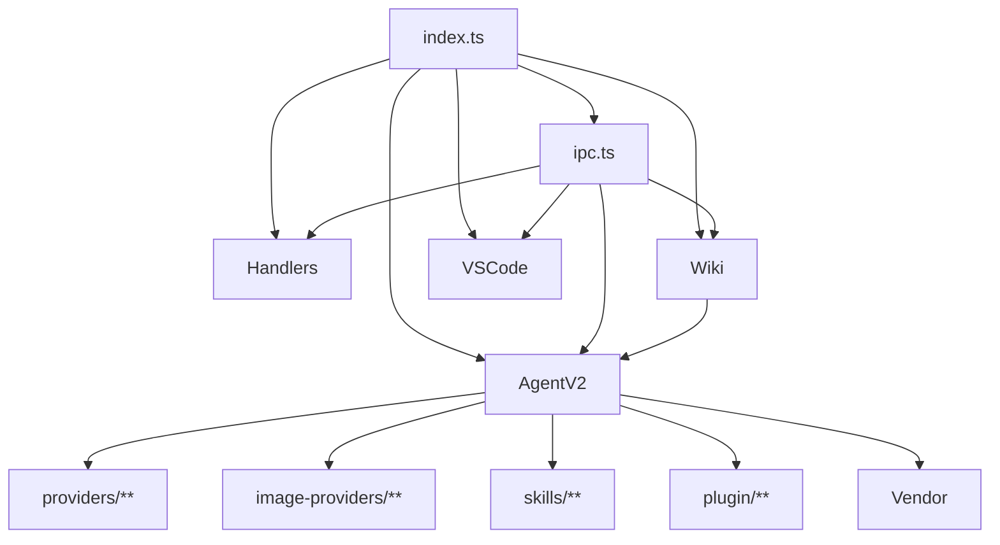
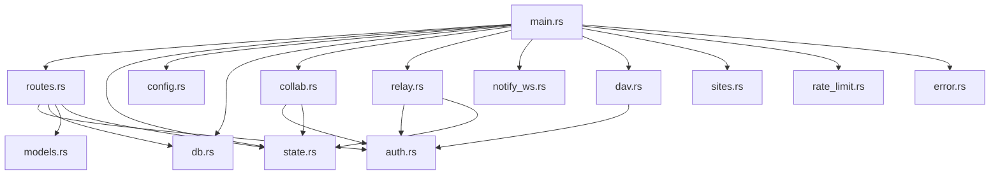

# Romantsy-Note 模块依赖

> 生成日期：2026-05-30
> 基线 commit：`92e125c7`（`main`）
> 范围：仓库内模块/包依赖关系

---

## 1. 顶层模块依赖图

```mermaid
flowchart TB
    subgraph Renderer["src/（渲染进程）"]
        App["App.tsx"]
        Components["components/**"]
        Editor["editor/**"]
        Stores["stores/**"]
        Services["services/**"]
        Lib["lib/**"]
        Config["config/** / i18n/** / styles/**"]
        Types["types/**"]
        Features["features/**"]
    end

    subgraph Preload["electron/preload"]
        Bridge["contextBridge + Tauri shim"]
    end

    subgraph Main["electron/main"]
        MainIndex["index.ts / ipc.ts"]
        Handlers["handlers/**"]
        AgentV2["agent-v2/**"]
        Wiki["wiki/**"]
        VSCode["vscode-extensions/**"]
        Vendor["vendor/**"]
    end

    subgraph Packages["packages/"]
        PluginApi["@lumina/plugin-api"]
        PluginUi["@lumina/plugin-ui"]
        Shared["@lumina/shared"]
    end

    subgraph Server["server/（Rust）"]
        RustApp["axum app"]
    end

    Components --> Stores
    Components --> Services
    Components --> Editor
    Editor --> Services
    Editor --> Stores
    Stores --> Services
    Stores --> Lib
    Services --> Lib
    Features --> Services
    Services -.-> PluginApi
    Services -.-> PluginUi
    Services -.-> Shared
    App --> Components

    Components -.->|"IPC"| Bridge
    Bridge --> MainIndex
    MainIndex --> Handlers
    MainIndex --> AgentV2
    MainIndex --> Wiki
    MainIndex --> VSCode
    AgentV2 --> Vendor

    RustApp -.->|"HTTP/WS"| Services
```

---

## 2. 渲染进程内部依赖

### 2.1 依赖规则（实际观察）

| 层 | 允许依赖 | 说明 |
|----|---------|------|
| components | stores / services / editor / lib / types | 视图层 |
| editor | stores / services / lib / types | 编辑器 |
| stores | services / lib / types | 状态层 |
| services | lib / types / packages | 服务层 |
| lib | types | 最底层（宿主桥） |

### 2.2 共享 store（跨域耦合点）

| store | 被哪些域使用 | 耦合说明 |
|-------|-------------|---------|
| `useFileStore` | 全域 | 标签页/文件树/vault，几乎所有域依赖 |
| `useUIStore` | 全域 | 主题/侧栏/模式 |
| `useNoteIndexStore` | wiki-graph, search | 反链/标签/图谱/搜索共享 |
| `useAIStore` | ai-agent, pdf-annotation, editor-markdown | 配置 + 引用 |
| `useErrorStore` / `useErrorBanner` | 全域 | 错误上报（通道重叠） |
| `usePluginStore` / `usePluginUiStore` | plugins-extensions, settings-theme | 插件与 UI 注入 |

### 2.3 已知耦合问题

| 问题 | 证据 | 影响 |
|------|------|------|
| 搜索不复用 note index | `SearchSidebar.tsx:113` vs `useNoteIndexStore.ts:331` | 两套读盘路径与结果类型 |
| `useCommandStore` 无消费方 | `ChatInput.tsx` 死代码 | 插件/自定义命令不可达 |
| `useErrorStore` 无消费方 | `useErrorStore.ts` | 三套错误通道 |
| 前后端模型目录双份 | `models.ts` vs `provider-bridge.ts` | 漂移 |

---

## 3. 主进程内部依赖

### 3.1 IPC 命令分组（`ipc.ts:171-215`）

| 组 | 文件 | 命令前缀 |
|----|------|---------|
| 文件系统 | `handlers/fs.ts` | `read_file/save_file/list_*` 等 |
| 平台 | `handlers/platform.ts` | `plugin:path|os|shell|process|clipboard|window|dialog` |
| 存储 | `handlers/store.ts` | `secure_store_*` / `plugin:store|*` |
| WebDAV | `handlers/webdav.ts` | `webdav_*` |
| 代理 | `handlers/proxy.ts` | `proxy_*` |
| 更新 | `handlers/updater.ts` | `update_*` |
| 诊断 | `handlers/diagnostics.ts` | `export_diagnostics` |
| 插件 | `handlers/plugins.ts` | `plugin_*` |
| VSCode | `handlers/vscodeExtensions.ts` | `vscode_extensions_*` |
| 许可证 | `handlers/luminaCloudLicense.ts` | `lumina_cloud_*` |
| Agent | `agent-v2/ipc-dispatch.ts` | `agent_/vault_/wiki_/image_/skill_` |
| 监听 | `handlers/watcher.ts` | `start_file_watcher` |
| 窗口 | `ipc.ts` | `window:*` |

> **缺口**：无 `mobile_*` 组（移动网关命令缺失）。

---

## 4. 包依赖（package.json）

### 4.1 核心运行时依赖

| 依赖 | 用途 | 消费方 |
|------|------|--------|
| `ai` + `@ai-sdk/*` + `@openrouter/ai-sdk-provider` + `ollama-ai-provider-v2` | 多 provider 模型调用 | 主进程 `agent-v2/providers` |
| `@opencode-ai/sdk` | AI agent 客户端 | 渲染 `services/opencode` |
| `@codemirror/*` + `@lezer/markdown` + `codemirror-live-markdown` | 编辑器内核 | `src/editor` |
| `zustand` | 状态管理 | `src/stores` |
| `react` / `react-dom` | UI | 全域 |
| `tailwindcss` / `clsx` / `tailwind-merge` | 样式 | UI |
| `framer-motion` | 动效 | UI |
| `lucide-react` | 图标 | UI |
| `katex` / `mermaid` / `lowlight` / `marked` / `turndown` | Markdown 渲染 | `services/markdown`, `editor` |
| `pdfjs-dist` / `react-pdf` | PDF | `components/pdf` |
| `@excalidraw/excalidraw` | 图表画布 | `components/diagram` |
| `webdav` | WebDAV 客户端 | 主进程 `handlers/webdav` |
| `@noble/ed25519` / `@noble/hashes` | 许可证校验 | `services/luminaCloud` |
| `electron-updater` | 自动更新 | 主进程 `handlers/updater` |
| `html2canvas` / `jspdf` | 导出 PDF | `services/pdf` |
| `chokidar` / `ignore` | 文件监听 | 主进程 `handlers/watcher` |
| `qrcode.react` | 移动网关 QR | `MobileGatewaySection` |
| `zod` / `yaml` | 校验/解析 | 多域 |

### 4.2 内部包

| 包 | 路径 | 导出 | 消费方 |
|----|------|------|--------|
| `@lumina/plugin-api` | `packages/plugin-api/index.d.ts` | `LuminaPluginApi`、清单类型、权限 | 插件运行时 |
| `@lumina/plugin-ui` | `packages/plugin-ui/` | 主题预设、CSS 变量工具 | 插件 |
| `@lumina/shared` | `packages/shared/src/cloud.ts` | 云契约类型 | `cloudSync`, `luminaCloud` |

---

## 5. 后端模块依赖（Rust）

### 5.1 后端 Cargo 依赖

`axum` + `tokio` + `sqlx`（sqlite）+ `yrs`（CRDT）+ `jsonwebtoken` + `argon2` + `governor`（限流）+ `serde`（`server/Cargo.toml:7-31`）。

---

## 6. 外部服务依赖

| 服务 | 用途 | 失败影响 | 证据 |
|------|------|---------|------|
| LLM Providers（11） | AI 对话/Agent | AI 不可用，本地功能不受影响 | `providers/registry.ts` |
| 图像 Providers（3） | AI 生图 | 生图失败 | `image-providers/registry.ts` |
| lumina-cloud | 许可证 + AI 网关 | Cloud provider 不可用 | `cloud/CONTRACT.md` |
| GitHub Releases | 更新 | 无法更新 | `electron-builder.yml:8` |
| VSCode Marketplace/OpenVSX | 扩展下载 | 扩展安装失败 | `vscodeExtensions.ts:276` |
| WebDAV 服务器 | 文件同步 | 同步失败（当前本就空实现） | `handlers/webdav.ts` |

---

## 7. 循环依赖与坏味道

| 问题 | 说明 |
|------|------|
| `useFileStore` 巨型 store | 承载标签/文件树/vault/移动同步，多域强耦合 |
| `MainAIChatShell.tsx`（97KB） | 超大组件，含输入/队列/导出/图片模式/调试面板 |
| `CodeMirrorEditor.tsx`（6361 行） | 巨型编辑器，职责过多 |
| `AgentMessageRenderer.tsx`（82KB） | 消息渲染巨型组件 |
| 服务层部分死代码 | `services/llm`、`ChatInput`、`ReadingView`、`useErrorStore` |
