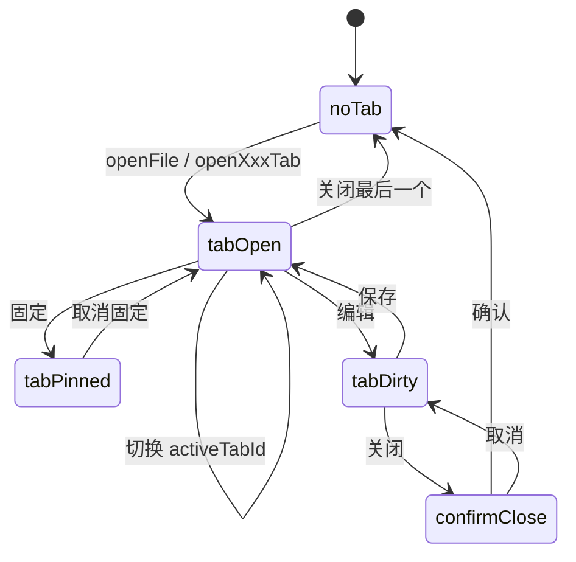
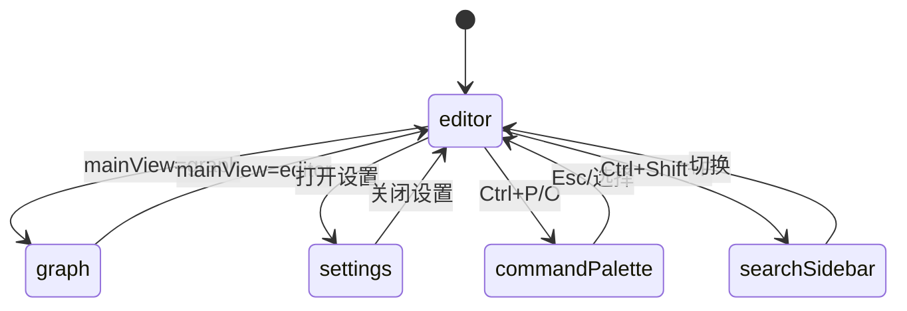

# Romantsy-Note 路由与状态管理

> 生成日期：2026-05-30
> 基线 commit：`92e125c7`（`main`）
> 范围：客户端"路由"（标签页/视图状态机）与 Zustand 状态管理

---

## 1. 路由模型说明

Romantsy-Note **没有 URL 路由**（Electron 单页应用），导航由两类状态承载：

1. **标签页**（`useFileStore` 的 `tabs` + `activeTabId`）——内容导航。
2. **视图状态**（`useUIStore` 的侧栏/面板/模式）——布局导航。

---

## 2. 标签页（内容路由）

### 2.1 标签类型

`TabType`（11 种）（`useFileStore.ts:31-42`）：

| TabType | 说明 | 打开方式 |
|---------|------|---------|
| `markdown` | 笔记文件 | `openFile` |
| `pdf` | PDF 文件 | `openPDFTab` |
| `image` | 图片查看 | 图片入口 |
| `graph` | 全局知识图谱 | 专用方法 |
| `isolated-graph` | 孤立节点图谱 | 专用方法 |
| `diagram` | Excalidraw 图表 | 专用方法 |
| `image-manager` | 图片管理器 | 专用方法 |
| `ai-chat` | AI 主标签页 | `openAIMainTab()` |
| `extensions-center` | 扩展中心 | 专用方法 |
| `plugin-view` | 插件 HTML 视图 | 插件 API |
| `settings` | 设置（若为标签） | — |

> 标签结构 `Tab`：`useFileStore.ts:53-69`；操作族：`useFileStore.ts:137-150`；特殊标签打开：`useFileStore.ts:156-164`。

### 2.2 标签页状态机

### 2.3 持久化

- 仅持久化 `vaultPath` + `recentFiles`（`useFileStore.ts:2791-2795`），水合时重建工作区（`useFileStore.ts:2796-2845`）。
- 标签页本身不跨会话持久化。

---

## 3. 视图状态（布局路由）

`useUIStore` 关键字段（`useUIStore.ts:16-106`）：

| 字段 | 类型 | 默认 | 说明 |
|------|------|------|------|
| `leftSidebarMode` | `"files" \| "search"` | files | 左栏模式 |
| `rightPanelTab` | `"chat" \| "outline" \| "backlinks" \| "tags" \| "vscode-ai"` | — | 右栏 tab |
| `mainView` | `"editor" \| "graph"` | editor | 主视图 |
| `editorMode` | `"reading" \| "live" \| "source"` | live | 编辑器模式 |
| `aiPanelMode` | `"docked" \| "floating"` | docked | AI 面板（floating 未实现） |
| `floatingPanelOpen` | boolean | false | 悬浮面板（未消费） |
| `isDarkMode` | boolean | false | 暗色 |
| `themeId` | string | default | 主题 |
| `editorFontSize` | number | 13 | 字号（10-32） |
| `blockEditorEnabled` | boolean | false | 块编辑器 |
| `slashCommandsEnabled` | boolean | true | 斜杠命令 |
| `isSettingsOpen` | boolean | — | 设置（不持久化） |

持久化白名单：`partializeUIState`（`useUIStore.ts:113-134`）；兼容旧 key `neurone-ui`（`useUIStore.ts:261`）。

### 3.1 视图状态机

---

## 4. 分屏状态

`useSplitStore`（`useSplitStore.ts:13-43`）：

| 字段 | 类型 | 说明 |
|------|------|------|
| `secondaryFileType` | `'markdown' \| 'pdf'` | 次面板类型 |
| `activePane` | `'primary' \| 'secondary'` | 活动面板 |
| `secondaryPdfPage` | number | PDF 页码 |
| `secondaryPdfAnnotationId` | string | 批注深链 |

---

## 5. Zustand store 清单

### 5.1 核心 store

| store | 职责 | 持久化 key |
|-------|------|-----------|
| `useFileStore` | 标签/文件树/vault/历史/移动同步 | `vaultPath`+`recentFiles` |
| `useUIStore` | 布局/主题/模式 | `lumina-ui` |
| `useNoteIndexStore` | 笔记索引（反链/标签/搜索） | 无 |
| `useAIStore` | LLM 配置 + 旧聊天会话 | `lumina-*` |
| `useOpencodeAgent` | 现役 agent 会话/流式/审批 | 无 |
| `useAgentProfileStore` | Agent 多配置 | `lumina-agent-*` |
| `useAgentPrefs` | 自动批准/上下文压缩 | 有 |
| `useSlashAIInlineStore` | 内联 AI 任务 | 无 |

### 5.2 功能 store

| store | 职责 | 持久化 |
|-------|------|--------|
| `useSplitStore` | 分屏 | 有 |
| `useRecentVaultStore` | 最近 vault（上限 8） | 有 |
| `useWorkspaceStore` | 工作区选项 | 有 |
| `useFavoriteStore` | 收藏 | 有 |
| `usePDFStore` / `usePDFAnnotationStore` | PDF 视图/批注 | 无 |
| `useImageManagerStore` | 图片管理器偏好 | `lumina-image-manager` |
| `useImageProvidersStore` | 图像 provider | 无（Key 在 keychain） |
| `usePluginStore` / `usePluginUiStore` | 插件状态/UI 注册表 | `lumina-plugins` |
| `useWebDAVStore` | WebDAV 配置 | `lumina-webdav-config` |
| `useCloudSyncStore` | 云账号/工作区 | `lumina-cloud-sync` |
| `useLicenseStore` | 许可证状态 | 无（keychain） |
| `useUpdateStore` | 更新 | `lumina-update` |
| `useLocaleStore` | 语言 | `lumina-locale` |
| `useCommandStore` | Slash 命令 | `lumina-commands` |
| `useCommandMenu` | Cmd+K 命令菜单 | 无 |
| `useErrorStore` / `useErrorBanner` | 错误（通道重叠） | 无 |

---

## 6. 导航触发入口

| 快捷键 | 动作 | 代码位置 |
|--------|------|---------|
| `Ctrl/Cmd+S` | 保存 | `App.tsx:846` |
| `Ctrl/Cmd+P` | 命令面板（command） | `App.tsx:852` |
| `Ctrl/Cmd+O` | 快速打开（file） | `App.tsx:860` |
| `Ctrl/Cmd+N` | 新建 | `App.tsx:868` |
| `Ctrl/Cmd+Shift+F` | 全局搜索 | `App.tsx:877` |
| `Ctrl/Cmd+K` | 命令菜单 | `command-menu-provider.tsx` |
| `Alt+←/→` | 导航前进/后退 | `Editor.tsx:540` |
| 插件热键 | 插件注册 | `runtime.ts:360-408,577-586`（App 优先分发 `App.tsx:886`） |

---

## 7. 状态管理风险

| 风险 | 证据 | 影响 |
|------|------|------|
| `useFileStore` 巨型化 | `useFileStore.ts`（多职责） | 耦合 |
| `aiPanelMode` floating 未实现 | `useUIStore.ts:14,45-53` | 死状态 |
| `isSettingsOpen` 持久化又强制重置 | `useUIStore.ts:264-289` | 冗余 |
| 代理双真源 | `useUIStore` + IPC | 不一致 |
| 三套错误通道 | `useErrorStore` 无消费 | 混乱 |
| 索引不增量更新 | `App.tsx:677-683` | 状态陈旧 |
| 无 URL 路由 | — | 无法深链（除 PDF `lumina://`） |
