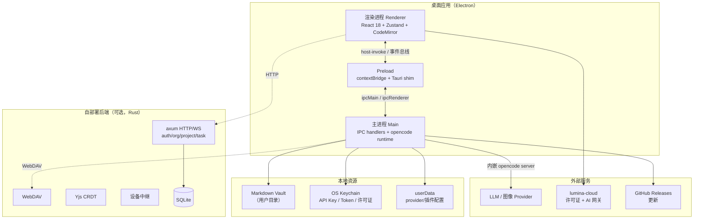
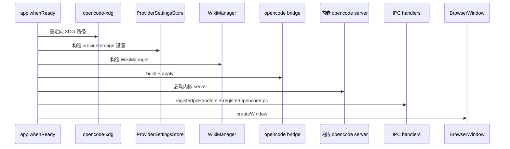
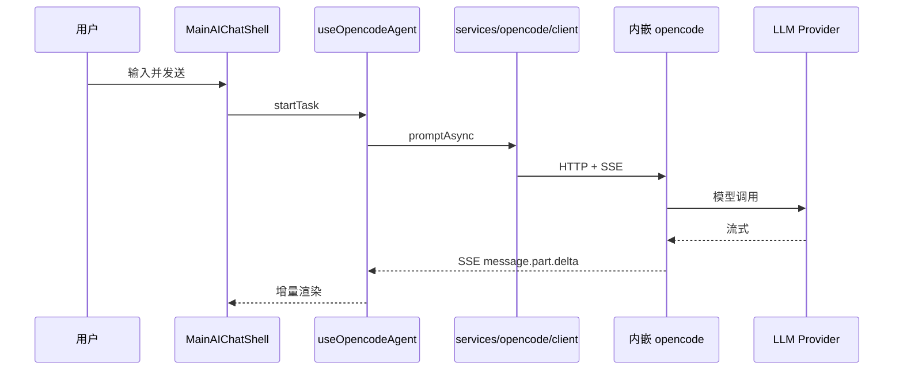
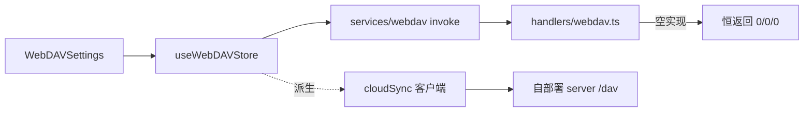

# Romantsy-Note 系统架构

> 生成日期：2026-05-30
> 基线 commit：`92e125c7`（`main`）
> 范围：全系统（Electron 桌面 + Rust 自部署后端 + 移动端 + 商业化）

---

## 1. 架构总览

Romantsy-Note 是一个 **local-first 的 Electron 桌面应用**，围绕本地 Markdown vault 构建，附带一个可选的 Rust 自部署后端用于跨设备同步/协作。系统分为四个可独立部署的部分：

---

## 2. 进程与运行时拓扑

### 2.1 Electron 三进程模型

| 进程 | 职责 | 入口 |
|------|------|------|
| Main | 窗口管理、IPC handler、文件系统、内嵌 opencode server、插件加载、更新 | `electron/main/index.ts:142` |
| Preload | `contextBridge` 安全桥 + Tauri v2 shim | `electron/preload/index.ts` |
| Renderer | React UI、状态、编辑器、业务编排 | `src/main.tsx`, `src/App.tsx` |

### 2.2 主进程装配时序

> 证据：`electron/main/index.ts:142-278`。

### 2.3 内嵌 opencode server

- 在 Electron 主进程内以 `Server.listen()` 启动（无子进程），健康检查 `/global/health`（`agent-v2/server.ts:1-80`）。
- provider 设置经 `provider-bridge.ts` 翻译为环境变量 `OPENCODE_CONFIG_CONTENT` / `OPENCODE_AUTH_CONTENT`，注入 `lumina-compat` provider、内嵌插件与 builtin skills（`provider-bridge.ts:1-52,575-592`）。
- 设置变更 → 150ms 防抖 → 重启 server → 通过 `opencode:server-changed` 通知渲染重置 client（`electron/main/index.ts:225-260`；`agent-v2/ipc.ts:45-61`）。

---

## 3. 分层架构

### 3.1 渲染进程分层

| 层 | 目录 | 职责 |
|----|------|------|
| 视图/组件 | `src/components/**`, `src/editor/**` | UI 渲染与交互 |
| 功能模块 | `src/features/**` | 跨组件功能（导出、VSCode 扩展） |
| Hook | `src/hooks/**` | 复用逻辑 |
| 状态 | `src/stores/**` | Zustand store（约 30+） |
| 服务 | `src/services/**` | 领域服务与外部集成 |
| 宿主桥 | `src/lib/host*.ts` | IPC 唯一入口 |
| 配置 | `src/config/**`, `src/i18n/**`, `src/styles/**` | 主题/i18n/样式 |

### 3.2 主进程分层

| 层 | 目录 | 职责 |
|----|------|------|
| 装配 | `electron/main/index.ts`, `ipc.ts` | 生命周期、命令路由 |
| Handler | `electron/main/handlers/**` | 文件系统/平台/存储/WebDAV/更新/诊断/插件/VSCode/许可证 |
| AI 运行时 | `electron/main/agent-v2/**` | opencode server、provider 桥、技能、图像 provider、插件 |
| Wiki | `electron/main/wiki/**` | 自动 wiki 合成（未启用） |
| 兼容 | `electron/main/vscode-extensions/**`, `vendor/**` | VSCode 扩展桥、node-pty |

### 3.3 后端分层（Rust）

| 层 | 文件 | 职责 |
|----|------|------|
| 启动/路由 | `server/src/main.rs` | Router 定义、中间件 |
| 处理器 | `server/src/routes.rs` | 账号/组织/项目/任务/批注/通知 |
| 协议 | `server/src/{dav,collab,relay,notify_ws}.rs` | WebDAV / CRDT / 中继 / 通知 WS |
| 鉴权 | `server/src/auth.rs` | Argon2 + JWT |
| 数据 | `server/src/db.rs`, `models.rs` | SQLite schema + 模型 |
| 基础设施 | `server/src/{state,config,rate_limit,error}.rs` | 状态/配置/限流/错误 |

---

## 4. 关键数据流

### 4.1 AI 对话链路

### 4.2 文件读写链路

### 4.3 同步链路（现状：断裂）

---

## 5. 部署拓扑

### 5.1 桌面端打包

- electron-builder：mac dmg+zip（arm64/x64）、win nsis（x64）、linux AppImage（x64）（`electron-builder.yml:43-87`）。
- `extraResources` 注入插件、技能、agent、VSCode host 脚本、平台 node-pty（`electron-builder.yml:22-34,57-70`）。
- release 工作流从 pinned commit 拉取 opencode 源码用 bun 构建（`.github/workflows/release.yml:123-147`）。

### 5.2 自部署后端

- Docker 多阶段 Rust 构建，非 root 用户，暴露 8787（`server/Dockerfile:1-37`）。
- `selfhost` compose：server + Caddy 反代 80/443（`docker-compose.selfhost.yml`）。
- `hosted` compose：仅 server 绑 `127.0.0.1:8787`（`docker-compose.hosted.yml`）。

---

## 6. 架构决策与约束

| 决策 | 说明 | 影响 |
|------|------|------|
| 本地优先 | vault 为纯 Markdown 文件，数据默认不出本地 | 隐私；同步为可选 |
| 内嵌 opencode | AI 运行时在主进程内，非子进程 | 无独立部署；重启影响会话 |
| Tauri→Electron 迁移 | 保留 Tauri 命令 shim | 旧命令名残留导致部分功能失败 |
| 双运行时并存 | 旧直连 LLM 改为抛错桩但未清理调用方 | 死路径风险 |
| 插件 `new Function` | 渲染进程内执行 | 开发便捷，安全弱 |
| 后端可选 | `server/` 独立，桌面可不部署 | 同步/协作需自建 |

---

## 7. 架构级风险

| 风险 | 影响 | 证据 |
|------|------|------|
| 迁移遗留命令名不一致 | 自定义主题等失败 | `themePlugin.ts:95` |
| 空实现伪成功 | 用户误信同步成功 | `handlers/webdav.ts:246` |
| 许可证 UI 孤立 | 商业化阻断 | `SettingsModal.tsx:76` |
| 插件沙箱弱 | 安全 | `runtime.ts:588` |
| 无系统托盘/全局快捷键 | 后台能力缺失 | `electron/main/index.ts:114-123` |
| 错误通道重叠 | 维护混乱 | `useErrorStore.ts`（无消费） |
