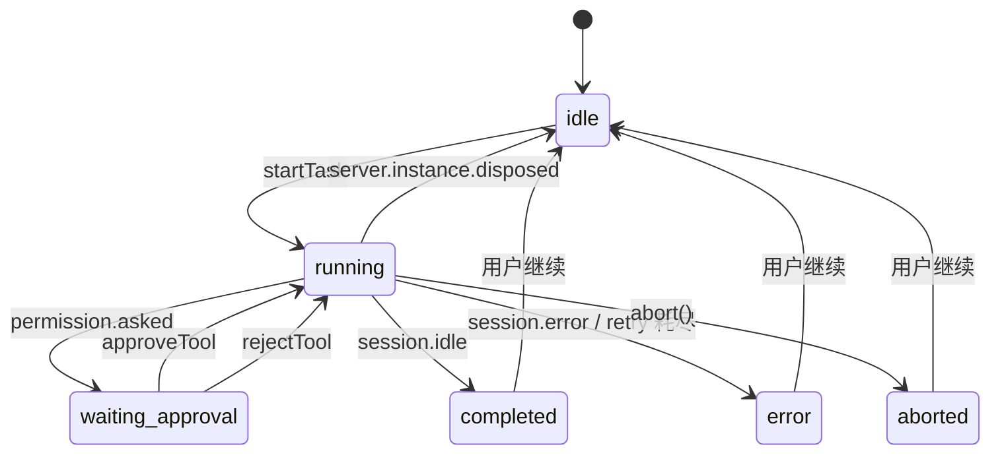

# AI Agent 与对话 域逆向 PRD

> 生成日期：2026-05-30
> 目标域：`ai-agent`
> 项目类型：fullstack（桌面端为主，前端视角）
> 代码版本：基于 `main` @ `92e125c7`
> 口径：以"实现现状"为准，对未实现/死代码明确标注缺口

## 目录

1. 概述
2. 功能需求
3. 状态机
4. 交互规范
5. 非功能需求
6. 风险与依赖
7. 附录：发现的问题

---

## 1. 概述

### 1.1 业务背景

Romantsy-Note 的核心卖点是"AI 不只是聊天，而是能真实编辑笔记"。本域提供内嵌的 opencode agent 运行时，让用户在一个统一的对话界面里完成：问答、读取/修改 vault 文件、执行命令、生成图片、调用技能。运行时位于 Electron 主进程内（非独立进程），渲染进程通过本地 HTTP + SSE 通信。

关键架构事实：**旧直连 LLM 运行时已废弃**（`src/services/llm/index.ts:93-124` 改为抛错桩），现役全部走 opencode；但仍有死路径调用方（见 §7）。

### 1.2 目标用户

| 角色 | 说明 | 核心操作 |
|------|------|---------|
| 笔记用户 | 日常写作用户，用 AI 辅助写作/整理 | 提问、@提及文件、接受 AI 修改 |
| 高级用户 | 关注模型与配置 | 配置多 provider、切换模型、管理技能 |
| 开发者用户 | 需要 agent 执行任务/命令 | 工具审批、自动批准、任务队列 |

### 1.3 页面清单

| 入口 | 位置 | 权限要求 | 说明 |
|------|------|---------|------|
| AI 主标签页 | `ai-chat` TabType | 需配置 provider | `MainAIChatShell.tsx` |
| AI 设置弹窗 | 设置 → AI | — | `AISettingsModal.tsx` |
| 图片模型设置 | AI 设置 → Image Models | — | `ImageModelsSettings.tsx` |
| 技能管理 | 扩展中心 → Skills | — | `ExtensionsCenterModal.tsx` |
| 编辑器内 slash AI | 编辑器 `/` | — | `SlashMenu.tsx`（默认关） |
| 选区 AI 工具条 | 编辑器选区 | — | `SelectionToolbar.tsx`（调用死路径） |

---

## 2. 功能需求

### 2.1 对话主体（FR-01｜func_code: `func_chat`）

#### 2.1.1 发送消息并流式接收

**功能描述**：用户在输入框输入内容并发送，系统把任务交给内嵌 opencode agent，通过 SSE 流式返回文本与工具调用。

**业务规则**：
1. 发送时 body 固定 `agent:"build"`，无独立 agent/chat 模式切换（`useOpencodeAgent.ts:1396-1400`）。
2. 生成过程中再次发送 → 进入客户端队列（`MainAIChatShell.tsx:441-533`），不并发。
3. 服务端返回 `session.status{retry}` 时进入重试态并显示倒计时（`useOpencodeAgent.ts:890`）。
4. 服务端实例销毁（重启）时中断当前任务，回 `idle` 并报错（`useOpencodeAgent.ts:814-833`）。

**表单/输入规则**：

| 字段 | 必填 | 格式要求 | 说明 |
|------|------|---------|------|
| 消息文本 | 是 | 非空 | 输入栏内联 |
| 附件/引用 | 否 | @提及文件 / 选区引用 | `QuoteReference` |

**交互行为**：

| 维度 | 描述 | 代码位置 |
|------|------|---------|
| 加载状态 | TypingIndicator（等待首 token，含计时） | `StreamingMessage.tsx:147-255` |
| 空状态 | 空会话欢迎区 + provider 状态卡 | `MainAIChatShell.tsx:1681-1725` |
| 错误状态 | blocker → sticky 红条；transient → toast | `useErrorBanner.ts:25`；`toastBridge.ts:16` |
| 操作反馈 | 停止按钮可中断；重试倒计时 | `MainAIChatShell.tsx:2401,2011` |

**验收标准**：
- [ ] 配置有效 provider 后，输入消息能流式收到回复。
- [ ] 生成中点击停止，任务中断且状态回 `aborted`。
- [ ] 网络失败时显示错误提示，本地功能不受影响。

#### 2.1.2 会话管理

**功能描述**：新建、切换、删除会话，查看历史。

**业务规则**：
1. 新建会话清空当前对话（`useOpencodeAgent.ts:1485-1501`）。
2. 删除会话**无二次确认**，乐观删除（`ChatHistorySidebar.tsx:81-91`）。

**交互行为**：

| 维度 | 描述 | 代码位置 |
|------|------|---------|
| 空状态 | 历史空态提示 | `ChatHistorySidebar.tsx:63-66` |
| 错误状态 | 删除失败仅后台报错，无回滚提示 | `useOpencodeAgent.ts:1279-1302` |

**验收标准**：
- [ ] 新建会话后消息列表清空。
- [ ] 切换会话后加载对应历史消息。

### 2.2 模型与 Provider（FR-02｜func_code: `func_configure_model`）

**功能描述**：用户在 AI 设置中配置 provider 的 API Key、baseURL、模型，并可测试连接。

**业务规则**：
1. 支持 11 个聊天 provider（anthropic/openai/google/deepseek/moonshot/glm/mimo/groq/openrouter/ollama/openai-compatible）（`registry.ts:59-242`）。
2. Ollama 免 API Key（`registry.ts:211`）。
3. `openai-compatible` 免 Key 但**强制 baseURL**（`provider-bridge.ts:573-586`）。
4. API Key 仅写不可读（存 OS keychain，键 `lumina:provider:apikey:<id>`），UI 不回显（`providers/settings-store.ts:92-98`）。
5. 设置变更触发 150ms 防抖后重启 opencode server（`electron/main/index.ts:225-260`）。
6. Lumina Cloud provider 需 `cloud_ai` feature 且构建期 `VITE_ROMANTSY_ENABLE_CLOUD==='1'` 才可见（`luminaCloud.ts:49-58`）。

**表单/输入规则**：

| 字段 | 必填 | 格式要求 | 联动规则 |
|------|------|---------|---------|
| API Key | 视 provider | 字符串 | Ollama 可空 |
| Base URL | 视 provider | URL | openai-compatible 必填 |
| Model ID | 是 | 字符串 | 从目录选择或自填 |

**交互行为**：

| 维度 | 描述 | 代码位置 |
|------|------|---------|
| 操作反馈 | 保存成功/失败 Toast | `AISettingsModal.tsx:213-217` |
| 弹窗生命周期 | 草稿态 + isDirty + Save/Reset | `AISettingsModal.tsx:180-224` |

**验收标准**：
- [ ] 填入有效 Key 后测试连接成功。
- [ ] 缺 Key/BaseURL/Model 时发送前置校验阻断（`runtime-readiness.ts:41-66`）。

### 2.3 文件提及与技能（FR-03｜func_code: `func_mention`）

**功能描述**：输入 `@` 提及 vault 文件，输入 `/` 选择 skill。

**业务规则**：
1. `@` 触发 mention Popover，过滤文件列表（`MainAIChatShell.tsx:2219-2247`）。
2. `/` 触发 skill Popover，从 opencode `GET /skill` 拉取并分类为 vault/builtin/external（`services/opencode/skills.ts:66-115`）。
3. 技能写入限定 `<vault>/.claude/skills/<name>/SKILL.md`，名称白名单 `^[a-z0-9][a-z0-9-]{0,63}$`（`skills/handlers.ts:17`）。

**验收标准**：
- [ ] 输入 `@` 显示文件候选，选择后作为引用上下文。
- [ ] 输入 `/` 显示技能候选，选择后作为 chip。

### 2.4 工具审批（FR-04｜func_code: `func_approve_tool`）

**功能描述**：agent 执行敏感操作（bash/外部目录/edit）时弹出审批卡，用户批准或拒绝。

**业务规则**：
1. 默认由 opencode 弹 `permission.asked`，渲染层转审批卡（`useOpencodeAgent.ts:736-777`）。
2. 批准为一次性 `once`，拒绝为 `reject`（`useOpencodeAgent.ts:483-528`）。
3. `autoApprove` 开启时整包 `permission:"allow"`，不再逐次询问（`useAgentPrefs.ts:31-34`）。
4. 审批状态由 `status="waiting_approval"` 承载。

**验收标准**：
- [ ] agent 请求 bash 权限时出现审批卡。
- [ ] 开启自动批准后不再出现审批卡。

### 2.5 会话导出（FR-05｜func_code: `func_export_conversation`）

**功能描述**：选择会话中的消息，导出为 Markdown 文件到 vault。

**业务规则**：
1. 仅支持 Markdown，**无 PDF/HTML**（`exportUtils.ts:180-198`）。
2. 写入 `<vault>/Exports/Conversations/agent-<safeTitle>.md`，重名自动加 `-2/-3`（`MainAIChatShell.tsx:809-826`）。
3. 导出模式固定为 `agent`，`chat` 分支不可达（`MainAIChatShell.tsx:797`）。
4. Agent 清洗依赖中文提示串与 `🔧/✅/❌` 前缀（`exportUtils.ts:29-39`）。

**交互行为**：

| 场景 | 反馈类型 | 内容 |
|------|---------|------|
| 进入/退出 | 工具栏切换 | `ai.exportConversation` / `ai.exportCancel` |
| 无可导出 | 空态 | `ai.exportNoMessages` |
| 导出失败 | `alert()` | `ai.exportFailed`（未用 toast） |

**验收标准**：
- [ ] 勾选消息后导出，文件出现在 `Exports/Conversations/`。
- [ ] 重名时自动追加序号。

### 2.6 内联 AI 与图片模式（FR-06｜func_code: `func_inline_ai`）

**功能描述**：编辑器内通过 `/` 触发 AI 生成；聊天区切换"图片模式"直接生图。

**业务规则**：
1. 内联 AI 阶段机：`understanding → reading-context → preparing-context → generating → ready`（`slashCommand.ts:52-65`）。
2. 同 tab 新任务会取消旧任务（`useSlashAIInlineStore.ts:70-74`）。
3. 图片模式：主模型可用 → 走 agent + image-gen skill；不可用 → 直连 image provider（`MainAIChatShell.tsx:1294,1161`）。
4. 内联 slash 默认关闭且注释标注"未完工：滚动时弹层不跟随光标"（`CodeMirrorEditor.tsx:5179`）。

**验收标准**：
- [ ] 图片模式下无主模型时能直连生图并返回 Markdown。
- [ ] 有主模型时通过 generate_image 工具生图。

---

## 3. 状态机

### 3.1 Agent 会话状态流转



**状态说明**：

| 状态 | 枚举值 | 说明 | 允许的操作 |
|------|--------|------|-----------|
| 空闲 | `idle` | 无进行中任务 | 发送、切换会话 |
| 运行中 | `running` | agent 处理中/流式输出 | 停止、排队 |
| 等待审批 | `waiting_approval` | 等待用户批准工具 | 批准、拒绝 |
| 完成 | `completed` | 任务正常结束 | 继续、导出 |
| 错误 | `error` | 任务失败 | 重试、查看错误 |
| 已中止 | `aborted` | 用户主动停止 | 继续 |

> 证据：`useOpencodeAgent.ts:57-63`。

### 3.2 内联 AI 阶段

```mermaid
stateDiagram-v2
    [*] --> understanding
    understanding --> reading-context
    reading-context --> preparing-context
    preparing-context --> generating
    generating --> ready
    generating --> error
```

---

## 4. 交互规范

### 4.1 加载与骨架屏策略

| 区块 | 加载方式 | 实现组件 | 代码位置 |
|------|---------|---------|---------|
| 等待首 token | 打字指示器 + 计时 | `TypingIndicator` | `StreamingMessage.tsx:147` |
| 流式消息 | 增量渲染 | `StreamingMessage` | `StreamingMessage.tsx:32` |
| 历史会话 | 无显式加载态 | — | `useSessionManagement.ts` |

### 4.2 空状态设计

| 区块 | 空状态文案 | 引导操作 | 代码位置 |
|------|----------|---------|---------|
| 欢迎区 | provider 状态卡（ok/warn/error/loading） | 去设置 | `MainAIChatShell.tsx:1681` |
| 历史侧栏 | 空态提示 | — | `ChatHistorySidebar.tsx:63` |
| @提及 | 无匹配提示 | — | `MainAIChatShell.tsx:2231` |
| skill | 空态/加载 | — | `MainAIChatShell.tsx:2193` |

### 4.3 错误状态设计

| 场景 | 错误展示方式 | 重试机制 | 代码位置 |
|------|-----------|---------|---------|
| blocker 错误 | sticky 红条 | 手动关闭 | `useErrorBanner.ts:25` |
| transient 错误 | sonner toast（5s） | — | `toastBridge.ts:16` |
| HTTP 请求失败 | 指数退避重试（最多 3 次，[250,750]ms） | 自动 | `errors/retry.ts:20-101` |
| provider 错误 | 分类文案（api_key_missing/quota/rate_limit/stream_lost） | — | `format.ts:50-79` |

### 4.4 操作反馈规范

**Toast/Message 规则**：

| 触发场景 | 类型 | 内容 |
|---------|------|------|
| AI 设置保存成功 | success | 成功提示 |
| AI 设置保存失败 | error | 失败提示 |
| 图片模式无 vault | error | `ai.imageDirect.noVault` |
| 图片模式无 provider | error | `ai.imageDirect.noImageProvider` |

**二次确认弹窗规则**：

| 触发操作 | 弹窗 | 现状 |
|---------|------|------|
| 删除 skill | `window.confirm` | ✅ 有确认 |
| 删除会话 | — | ❌ 无确认（缺口） |

---

## 5. 非功能需求

### 5.1 性能要求

- SSE 断线重连指数退避：500ms×2ⁿ 上限 5s（`useOpencodeAgent.ts:1142`）。
- token 级增量渲染（`message.part.delta` 前置处理）（`useOpencodeAgent.ts:795-813`）。
- provider 设置变更防抖 150ms 后重启 server。

### 5.2 权限与安全

- API Key 仅存 OS keychain，渲染层只写不读。
- 工具执行默认需用户审批；自动批准为显式 opt-in。
- opencode 全局路径隔离，禁用外部技能继承（`opencode-xdg.ts:57-68`）。

---

## 6. 风险与依赖

### 6.1 前置依赖

| 依赖项 | 类型 | 说明 |
|--------|------|------|
| 内嵌 opencode server | 内部运行时 | 所有 AI 能力依赖，启动失败则 AI 不可用 |
| 模型 provider API | 外部服务 | 需有效 Key；不可用时降级为本地/离线 |
| OS keychain | 系统 | API Key 存储；Linux 无 keychain 时软回退 |
| Lumina Cloud | 外部服务 | 可选，需许可证 + 构建开关 |

### 6.2 已知风险与约束

| 风险/约束 | 影响 | 现有处理 / 建议 |
|---------|------|--------------|
| 旧 LLM 运行时死路径仍被调用 | 选区 AI/语音笔记必抛错 | 迁移到 opencode 或显式下线 |
| 模型目录前后端双份维护 | 新增模型易漂移 | 统一数据源 |
| SSE 日志未按 env 门控 | 生产刷日志 | 加环境判断 |
| effort/mode UI 缺失但类型/文案仍在 | 用户困惑 | 补 UI 或清理 |
| 删除会话无确认 | 误删 | 加二次确认 |

---

## 7. 附录：发现的问题

| 级别 | 类型 | 影响范围 | 发现路径（文件:行） | 问题描述 |
|------|------|---------|-------------------|---------|
| P0 | 流程编排 | 选区 AI / 语音笔记 | `services/llm/index.ts:93-124`；`SelectionToolbar.tsx:246` | `callLLM/callLLMStream` 已改抛错桩，但仍有调用方，触发必失败 |
| P0 | 功能不可达 | 自定义 slash command | `ChatInput.tsx`（无引用）；`useCommandStore.ts` | 组件死代码，用户创建的命令无消费方 |
| P1 | 状态形状空置 | 调试面板 | `useOpencodeAgent.ts:272-294`；`MainAIChatShell.tsx:2516` | `queuedTasks/debugPromptStack` 恒空但 UI 仍渲染 |
| P1 | 功能不可达 | effort/mode 选择 | `useAIStore.ts:1111-1112` | 类型与文案存在，无 UI，rehydrate 主动删除字段 |
| P1 | 交互缺陷 | 删除会话 | `ChatHistorySidebar.tsx:81-91` | 无二次确认，乐观删除且失败无回滚提示 |
| P2 | i18n | Provider 状态卡等 | `MainAIChatShell.tsx:275-311,1721,2266` | 硬编码中文，绕过 i18n |
| P2 | 安全 | 错误日志 | `errors/persistence.ts:96-116` | `error.cause` 含敏感信息落盘未脱敏 |
| P2 | 数据一致性 | provider 目录 | `models.ts:250-670` vs `provider-bridge.ts:173-248` | 模型列表双份维护，易漂移 |
| P2 | 可观测 | SSE 日志 | `useOpencodeAgent.ts:785-789` | 生产环境 `console.log` 刷日志 |
| P3 | 功能不可达 | SkillManagerModal | `App.tsx:604-608` | 打开被重定向到扩展中心，自身 Dialog 分支不可达 |
