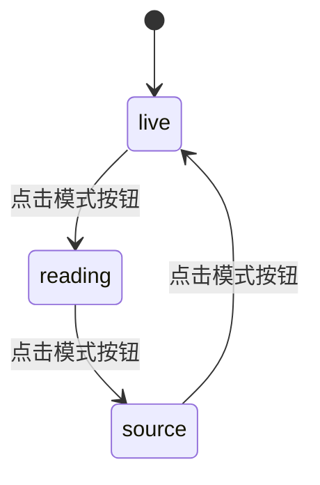
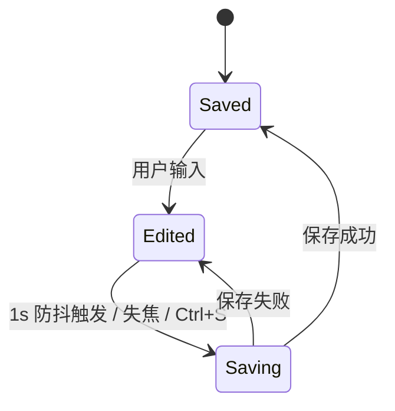

# 编辑器与 Markdown 域逆向 PRD

> 生成日期：2026-05-30
> 目标域：`editor-markdown`
> 项目类型：fullstack（桌面端为主，前端视角）
> 代码版本：基于 `main` @ `92e125c7`
> 口径：以"实现现状"为准，对未实现/死代码明确标注缺口

## 目录

1. 概述
2. 功能需求
3. 状态机
4. 交互规范
5. 非功能需求
6. 风险与依赖
7. 附录：发现的问题

---

## 1. 概述

### 1.1 业务背景

编辑器是产品的"主桌面"。Romantsy-Note 使用 CodeMirror 6 实现 Markdown 源码 / 实时预览 / 阅读三种模式，并在实时模式内联渲染 LaTeX、Mermaid、代码高亮、图片与表格。文件以标签页组织，支持分屏，笔记以本地 Markdown 文件持久化。

关键架构事实：三种模式**共用同一个 CodeMirror 实例**（`Editor.tsx:852-868`），阅读模式通过 `EditorState.readOnly` 实现；独立的 `ReadingView.tsx` 是死代码。

### 1.2 目标用户

| 角色 | 说明 | 核心操作 |
|------|------|---------|
| 写作用户 | 日常 Markdown 写作 | 编辑、格式化、预览 |
| 多文档用户 | 同时处理多篇笔记/PDF | 标签页、分屏 |
| 长文用户 | 大量笔记 | 文件树、最近 vault、大纲导航 |

### 1.3 页面清单

| 入口 | 位置 | 说明 |
|------|------|------|
| 编辑器主区 | 主面板 | `Editor.tsx` |
| 分屏次面板 | 主/次面板 | `SplitEditor.tsx` |
| 文件树 | 左栏 | `Sidebar` / `FileTree` |
| 标签栏 | 顶部 | `TabBar.tsx` |
| 欢迎页 | 首次启动 | `WelcomeScreen.tsx` |

---

## 2. 功能需求

### 2.1 编辑模式（FR-01｜func_code: `func_edit_mode`）

#### 2.1.1 三模式切换

**功能描述**：用户点击模式按钮在 `live → reading → source` 间循环切换；同一 CodeMirror 实例保持，避免滚动/行盒跳变。

**业务规则**：
1. 循环顺序固定 `live → reading → source → live`（`Editor.tsx:743-754`）。
2. 默认模式 `live`（`useUIStore.ts:212`），可在设置修改（`GeneralSection.tsx:232-241`）。
3. 阅读模式通过 `readOnly` 实现，非独立视图（`CodeMirrorEditor.tsx:4841-4843`）。
4. 模式切换保存滚动快照并做转场恢复（`CodeMirrorEditor.tsx:4858,5010-5077`）。

**交互行为**：

| 维度 | 描述 | 代码位置 |
|------|------|---------|
| 加载状态 | 无（即时切换） | — |
| 空状态 | 无文件时显示欢迎/空提示 | `Editor.tsx` |

**验收标准**：
- [ ] 点击模式按钮按 live→reading→source 循环。
- [ ] 切换后滚动位置大致保持。

#### 2.1.2 Markdown 格式化

**功能描述**：工具栏提供加粗/斜体/删除线/行内代码/超链接/H1-H3/无序/有序/任务/引用。

**业务规则**：
1. 工具栏派发 `editor-format-text` 自定义事件，由编辑器统一处理（`Editor.tsx:305-311`, `CodeMirrorEditor.tsx:6054-6142`）。
2. 实现支持 `highlight`/`wikilink` 格式，但工具栏未暴露入口（`CodeMirrorEditor.tsx:6078,6086`）。

**验收标准**：
- [ ] 选中文本后点击加粗，文本被 `**` 包裹。

### 2.2 文件与标签页（FR-02｜func_code: `func_manage_tabs`）

**功能描述**：打开/切换/关闭标签页；标签页支持 11 种类型（markdown/pdf/graph/isolated-graph/diagram/image/ai-chat/image-manager/extensions-center/plugin-view）。

**业务规则**：
1. 标签类型见 `useFileStore.ts:31-42`。
2. 特殊标签通过专用方法打开（`useFileStore.ts:156-164`）。
3. 自动保存：停止输入 1000ms 防抖（`Editor.tsx:599-606`, `useFileStore.ts:201`）。
4. 窗口失焦触发保存（`Editor.tsx:609-617`）。

**交互行为**：

| 维度 | 描述 | 代码位置 |
|------|------|---------|
| 操作反馈 | Saving 转圈 / Edited 脉冲点 / Saved 对勾（`aria-live`） | `Editor.tsx:761-785` |
| 关闭确认 | 有未保存文件时关窗弹确认 | `electron/main/index.ts:86-103` |

**验收标准**：
- [ ] 打开文件生成对应标签。
- [ ] 停止输入约 1s 后自动保存并显示 Saved。

### 2.3 分屏（FR-03｜func_code: `func_split_view`）

**功能描述**：主/次面板分屏，支持水平/垂直与拖拽分割，PDF 可作为次面板。

**业务规则**：
1. 次面板文件类型 `markdown | pdf`（`useSplitStore.ts:7`）。
2. PDF 引用 Ctrl/Cmd+点击可分栏打开并定位页码/高亮（`SplitEditor.tsx:122-146`）。

**验收标准**：
- [ ] 打开分屏后主/次面板独立编辑。
- [ ] PDF 作为次面板可正常渲染。

### 2.4 Vault 工作区（FR-04｜func_code: `func_open_vault`）

**功能描述**：首次启动选择本地文件夹作为 vault，创建 `.lumina` 结构，维护文件树与最近列表。

**业务规则**：
1. 选择时先 `estimateDirSize` 预估，过大弹 `window.confirm` 预警（`useFileStore.ts:496-512`）。
2. 创建 `.lumina`、`.lumina/skills`、`.lumina/plugins`（`useFileStore.ts:539-570`）。
3. 最近 vault 上限 8（`useRecentVaultStore.ts:17`）。
4. 仅持久化 `vaultPath` + `recentFiles`，水合时重建（`useFileStore.ts:2791-2845`）。
5. 工作区过大枚举错误保留旧树（`useFileStore.ts:581-611`）。

**验收标准**：
- [ ] 选择文件夹后生成 `.lumina` 并加载文件树。
- [ ] 超大目录给出预警。

### 2.5 Markdown 渲染能力（FR-05｜func_code: `func_render_markdown`）

**功能描述**：实时渲染 LaTeX、Mermaid、代码高亮、图片、表格、Callout。

**业务规则**：
1. LaTeX 用 `katex`，块/行内 math 占位符法渲染（`markdown.ts:364-373`, `CodeMirrorEditor.tsx:1211`）。
2. Mermaid 异步 `mermaid.run`，live 模式代码块跳过（`LIVE_CODE_BLOCK_SKIPPED_LANGUAGES=["mermaid"]`）（`CodeMirrorEditor.tsx:1402,2228`）。
3. 代码高亮用 `lowlight`（`CodeMirrorEditor.tsx:2229-2231`）。
4. 图片支持 `` 与 `![[...]]`（`CodeMirrorEditor.tsx:4382-4461`）。
5. 表格只读单元格渲染行内 MD（`tableInlineMarkdownPlugin.ts:1-27`）。

**验收标准**：
- [ ] `$$...$$` 渲染为公式。
- [ ] ` ```mermaid ` 渲染为图表。
- [ ] 代码块带语法高亮与复制按钮。

### 2.6 导出与导航（FR-06｜func_code: `func_navigate`）

**功能描述**：Alt+←/→ 前进后退；工具栏导出笔记为 PDF。

**业务规则**：
1. 导航历史 `HistoryEntry.type: "user" | "ai"`（`useFileStore.ts:22-28`）。
2. 导出 PDF 用 `jspdf + html2canvas`（`services/pdf/exportPdf.ts:4-5`）。

**验收标准**：
- [ ] Alt+← 返回上一位置。
- [ ] 导出 PDF 生成文件。

---

## 3. 状态机

### 3.1 视图模式



**状态说明**：

| 状态 | 枚举值 | 说明 |
|------|--------|------|
| 实时预览 | `live` | 编辑 + 内联渲染，默认 |
| 阅读 | `reading` | 只读渲染 |
| 源码 | `source` | 纯 Markdown 源码 |

### 3.2 保存状态



### 3.3 工作区同步状态

`MobileWorkspaceSyncStatus.status: idle | syncing | confirmed | error`（`useFileStore.ts:71-78`）。

---

## 4. 交互规范

### 4.1 加载与骨架屏策略

| 区块 | 加载方式 | 代码位置 |
|------|---------|---------|
| 分屏次面板 | 加载转圈 | `SplitEditor.tsx:40-56` |
| 编辑器 | 无骨架屏（即时） | — |

### 4.2 空状态设计

| 区块 | 空状态 | 代码位置 |
|------|-------|---------|
| 分屏空文件 | 提示文案 | `SplitEditor.tsx:40-56` |
| 块编辑器空段落 | 占位符 | `CodeMirrorEditor.tsx:285-286` |

### 4.3 错误状态设计

| 场景 | 展示方式 | 代码位置 |
|------|---------|---------|
| vault 过大/系统目录 | 非阻塞 `window.confirm` | `useFileStore.ts:496-512` |
| 工作区超限 | 保留旧树 + 枚举错误 | `useFileStore.ts:581-659` |
| 图片加载失败 | 写入 `img.alt` | `ReadingView.tsx:108`（死代码） |

### 4.4 数据展示格式规范

| 数据类型 | 格式规则 | 代码位置 |
|---------|---------|---------|
| 保存状态 | Saving/Edited/Saved 三态 | `Editor.tsx:761` |
| 编辑器字号 | 设置可调 10-32 | `GeneralSection.tsx` |

---

## 5. 非功能需求

### 5.1 性能要求

- 同一 CodeMirror 实例贯穿三模式，避免重建。
- 大文件/大目录保护：工作区过大枚举错误。
- 滚动行号估算：`lineHeight = 28` 硬编码（`Editor.tsx:184-193`），与主题字号/块 widget 高度不一致（缺口）。

### 5.2 兼容性

- `codemirror-live-markdown` 提供 live/reading 插件。
- KaTeX/Mermaid/lowlight 均本地打包，离线可用。

---

## 6. 风险与依赖

### 6.1 前置依赖

| 依赖项 | 类型 | 说明 |
|--------|------|------|
| CodeMirror 6 | 内部库 | 编辑器内核 |
| codemirror-live-markdown | 开源组件 | live/reading 渲染 |
| 本地文件系统 | 系统 | 笔记持久化 |

### 6.2 已知风险与约束

| 风险/约束 | 影响 | 现有处理 / 建议 |
|---------|------|--------------|
| `ReadingView.tsx` 死代码 | 维护混淆、功能不一致 | 删除或接入 |
| 无 `[[` 自动补全 | 输入体验 | 引入 autocompletion |
| frontmatter 无编辑器 UI | 用户无法编辑属性 | 补属性面板 |
| `ViewMode`/`EditorMode` 双份定义 | 类型漂移 | 统一 |
| 斜杠命令默认关闭且未完工 | 功能不可达 | 完成或下线 |

---

## 7. 附录：发现的问题

| 级别 | 类型 | 影响范围 | 发现路径（文件:行） | 问题描述 |
|------|------|---------|-------------------|---------|
| P1 | 死代码 | 阅读视图 | `src/editor/ReadingView.tsx`（仅测试引用） | Mermaid/图片 base64/callout/wikilink 逻辑均不在生产路径 |
| P1 | 功能缺失 | WikiLink | `CodeMirrorEditor.tsx:4125-4148` | 无 `[[` 自动补全 |
| P2 | 未完工 | 斜杠命令 | `CodeMirrorEditor.tsx:5179` | 默认关闭，弹层不跟随光标 |
| P2 | i18n | 格式工具栏 | `Editor.tsx:651-736` | `加粗 (Bold)` 等中文硬编码 |
| P2 | 类型漂移 | 视图模式 | `CodeMirrorEditor.tsx:88` vs `useUIStore.ts:8` | `ViewMode`/`EditorMode` 双份定义 |
| P2 | 功能缺失 | frontmatter | `frontmatter.ts` | 无属性编辑 UI |
| P3 | 估算粗糙 | 滚动定位 | `Editor.tsx:184-193` | `lineHeight=28` 硬编码 |
