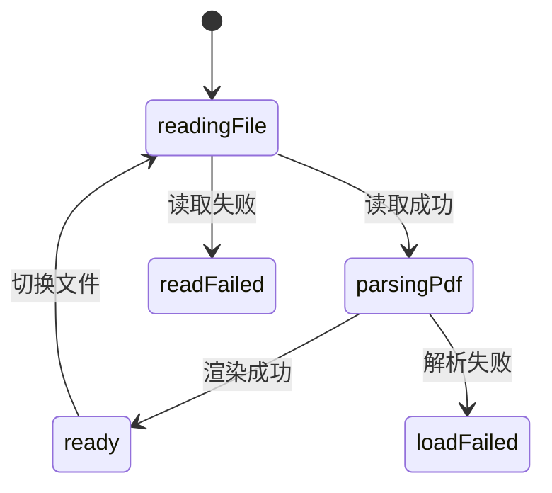

# PDF 阅读与批注 域逆向 PRD

> 生成日期：2026-05-30
> 目标域：`pdf-annotation`
> 项目类型：fullstack（桌面端为主，前端视角）
> 代码版本：基于 `main` @ `92e125c7`
> 口径：以"实现现状"为准，对未实现/死代码明确标注缺口

## 目录

1. 概述
2. 功能需求
3. 状态机
4. 交互规范
5. 非功能需求
6. 风险与依赖
7. 附录：发现的问题

---

## 1. 概述

### 1.1 业务背景

内置 PDF 阅读器让用户在应用内阅读 PDF、做高亮/下划线/笔记批注，并把批注持久化为与 PDF 同目录的 Markdown 文件；选中内容可直接送入 AI 上下文。技术栈 `pdfjs-dist` + `react-pdf`。

### 1.2 目标用户

| 角色 | 说明 | 核心操作 |
|------|------|---------|
| 研究者 | 读论文做标注 | 高亮、下划线、笔记 |
| 学习者 | 读教材摘录 | 批注、发送到 AI |

### 1.3 页面清单

| 入口 | 位置 | 说明 |
|------|------|------|
| PDF 标签页 | 主区 | `PDFViewer.tsx` |
| 分栏 PDF | 次面板 | `SplitEditor.tsx` |

---

## 2. 功能需求

### 2.1 PDF 阅读（FR-01｜func_code: `func_read_pdf`）

**功能描述**：打开 PDF 标签页，翻页、缩放、目录导航、全文搜索。

**业务规则**：
1. Worker 本地打包（非 CDN）（`src/pdfWorker.ts:1-7`）。
2. 数据副本策略：search/outline/canvas 各 `slice()` 一份，canvas 再复制一份规避 detached（`PDFViewer.tsx:89-103`；`PDFCanvas.tsx:218-226`）。
3. 缩放预设 50/75/100/125/150/200%，Ctrl/Cmd+滚轮以鼠标为中心缩放（`PDFToolbar.tsx:26`；`PDFCanvas.tsx:174-216`）。
4. 单页渲染（只渲染 `currentPage`）（`PDFCanvas.tsx:275-285`）。
5. 旋转按钮渲染但**无 onClick**（`PDFToolbar.tsx:151-156`）。
6. 适应宽度 prop 未传入，按钮永不出现（`PDFViewer.tsx:154-166`）。

**交互行为**：

| 维度 | 描述 | 代码位置 |
|------|------|---------|
| 加载状态 | `readingFile` / `parsingPdf` | `PDFViewer.tsx:106-121`；`PDFCanvas.tsx:262-267` |
| 错误状态 | `readFailed` / `loadFailed` | `PDFViewer.tsx:61-68,124-141` |
| 目录加载/空 | spinner / `outlineEmpty` | `PDFOutline.tsx:158-173` |
| 搜索无结果 | `pdfViewer.search.noResults` | `PDFSearch.tsx:223-225` |

**验收标准**：
- [ ] 打开 PDF 正确渲染当前页。
- [ ] 翻页/缩放/目录跳转正常。
- [ ] 全文搜索定位到匹配页（当前无页面高亮）。

### 2.2 批注（FR-02｜func_code: `func_annotate`）

**功能描述**：选中文本弹浮层，添加高亮/下划线/笔记，5 种颜色，批注叠加显示，持久化到 Markdown。

**业务规则**：
1. 批注类型 `highlight | underline | note`（`types/annotation.ts:6`）。
2. 颜色 `yellow/green/blue/pink/purple`（`types/annotation.ts:9`）。
3. 持久化为 `<name>.annotations.md`，含引用块、笔记、跳转链接与隐藏元数据（`annotations.ts:35-38,206-271`）。
4. 批注回跳链接 `lumina://pdf?file=...&page=...&id=...`（`annotations.ts:249`）。
5. **编辑批注为 TODO 空实现**（`AnnotationLayer.tsx:42-45`）。
6. **主视图不应用页码/批注深链**（仅分栏生效）（`ReadingView.tsx:152-154`；`useFileStore.ts:1549`）。

**交互行为**：

| 维度 | 描述 | 代码位置 |
|------|------|---------|
| 删除确认 | `deleteConfirm` | `AnnotationLayer.tsx:53-56` |
| 加载/保存失败 | `annotation.loadFailed` / `saveFailed` | `usePDFAnnotationStore.ts:110,150` |
| 高亮闪烁 | 3 秒自动清除 | `usePDFAnnotationStore.ts:239-250` |

**验收标准**：
- [ ] 选中文本后浮层可添加高亮/下划线/笔记。
- [ ] 批注保存到同目录 `.annotations.md`。
- [ ] 重启后批注重新加载显示。

### 2.3 发送到 AI（FR-03｜func_code: `func_send_to_ai`）

**功能描述**：浮层 Sparkles 按钮把选中内容写入 AI 上下文引用。

**业务规则**：
1. 写入 `useAIStore.addTextSelection`，附 `range.kind="pdf"` 与页码（`AnnotationPopover.tsx:93-116`）。
2. 引用类型 `QuoteReference`（`types/chat.ts:33-41`）。

**验收标准**：
- [ ] 选中 PDF 内容点 Sparkles 后，AI 输入栏出现引用。

### 2.4 笔记导出 PDF（FR-04｜func_code: `func_export_pdf`）

**功能描述**：编辑器工具栏把笔记导出为 PDF（与本域相关但独立）。

**业务规则**：
1. `jspdf + html2canvas`（`services/pdf/exportPdf.ts:4-5,80-110`）。
2. 使用保存对话框（与对话导出写 vault 不同）。

**验收标准**：
- [ ] 导出生成 PDF 文件。

---

## 3. 状态机

### 3.1 PDF 加载状态

### 3.2 批注弹层状态

`AnnotationPopoverState`：`isOpen/x/y/selectedText/position`（`types/annotation.ts:49-57`）。

---

## 4. 交互规范

### 4.1 加载与骨架屏策略

| 区块 | 加载方式 | 代码位置 |
|------|---------|---------|
| 文件读取 | `readingFile` 文案 | `PDFViewer.tsx:106` |
| PDF 解析 | `parsingPdf` 文案 | `PDFCanvas.tsx:262` |
| 目录 | spinner | `PDFOutline.tsx:158` |

### 4.2 空状态设计

| 区块 | 空状态文案 | 代码位置 |
|------|----------|---------|
| 目录 | `outlineEmpty` | `PDFOutline.tsx:166-173` |
| 搜索 | `search.noResults` | `PDFSearch.tsx:223` |

### 4.3 错误状态设计

| 场景 | 展示方式 | 代码位置 |
|------|---------|---------|
| 读取失败 | `readFailed` / `loadFailed` | `PDFViewer.tsx:61,124` |
| 批注加载/保存失败 | 对应文案 | `usePDFAnnotationStore.ts:110,150` |

### 4.4 操作反馈规范

| 场景 | 反馈 | 代码位置 |
|------|------|---------|
| 删除批注 | 右键确认 | `AnnotationLayer.tsx:48-58` |
| 高亮定位 | 3s 闪烁 | `usePDFAnnotationStore.ts:239` |

---

## 5. 非功能需求

### 5.1 性能要求

- 单页渲染（非连续滚动）。
- **内存缺口**：同一 PDF 被复制 4 次（`PDFViewer.tsx:89-103` ×3 + `PDFCanvas.tsx:218-226`）。

### 5.2 兼容性

- `pdfjs-dist` worker 本地打包，离线可用。

---

## 6. 风险与依赖

### 6.1 前置依赖

| 依赖项 | 类型 | 说明 |
|--------|------|------|
| pdfjs-dist / react-pdf | 开源库 | PDF 渲染 |
| jspdf / html2canvas | 开源库 | 导出 PDF |
| AI 上下文 | 内部 | 发送到 AI |

### 6.2 已知风险与约束

| 风险/约束 | 影响 | 现有处理 / 建议 |
|---------|------|--------------|
| PDF 数据 4 份副本 | 内存放大 | 共享 ArrayBuffer 策略 |
| 错误识别靠字符串 | 脆弱 | 用错误码 |
| locale 触发重载 | 切语言重读文件 | 移出依赖 |
| 单页渲染无缩略图 | 大文档导航差 | 启用缩略图 |

---

## 7. 附录：发现的问题

| 级别 | 类型 | 影响范围 | 发现路径（文件:行） | 问题描述 |
|------|------|---------|-------------------|---------|
| P1 | 死控件 | PDF 工具栏 | `PDFToolbar.tsx:151-156` | 旋转按钮无 onClick |
| P1 | 功能缺失 | PDF 工具栏 | `PDFToolbar.tsx:136-144`；`PDFViewer.tsx:154-166` | 适应宽度 prop 未传入 |
| P1 | 死代码 | PDF | `PDFThumbnails.tsx` | 缩略图组件未被使用 |
| P1 | TODO | 批注 | `AnnotationLayer.tsx:42-45` | 批注点击编辑为空实现 |
| P1 | 功能不一致 | 批注深链 | `ReadingView.tsx:152-154`；`useFileStore.ts:1549` | 主视图不应用页码/批注深链，仅分栏支持 |
| P2 | 搜索质量 | PDF 搜索 | `PDFSearch.tsx:78-82` | 拼接 item.str 无空格，可能假匹配；无页面高亮 |
| P2 | 内存 | PDF | `PDFViewer.tsx:89-103`；`PDFCanvas.tsx:218-226` | 同一 PDF 复制 4 次 |
| P2 | 健壮性 | 批注 | `usePDFAnnotationStore.ts:107` | 靠字符串判断文件缺失 |
| P3 | 未使用字段 | 批注 | `annotation.ts:21-23` | `textBefore/textAfter` 定义但未使用 |
