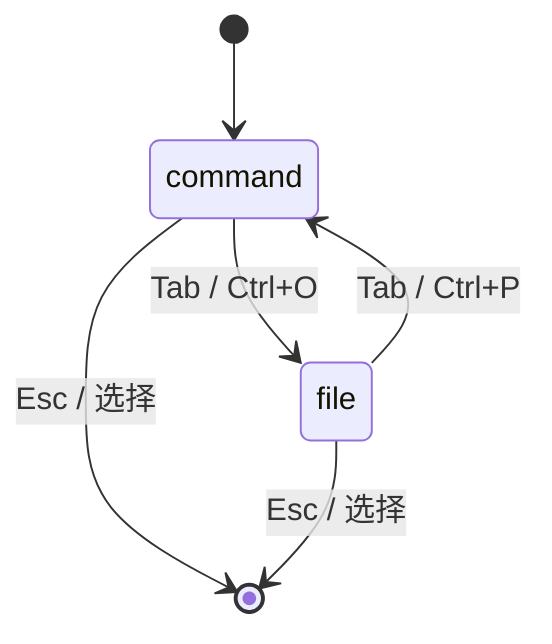
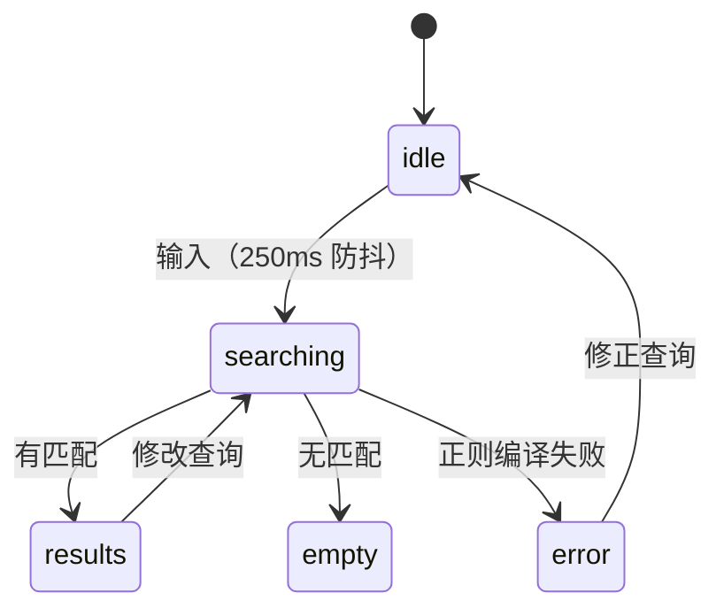

# 搜索与命令面板 域逆向 PRD

> 生成日期：2026-05-30
> 目标域：`search`
> 项目类型：fullstack（桌面端为主，前端视角）
> 代码版本：基于 `main` @ `92e125c7`
> 口径：以"实现现状"为准，对未实现/死代码明确标注缺口

## 目录

1. 概述
2. 功能需求
3. 状态机
4. 交互规范
5. 非功能需求
6. 风险与依赖
7. 附录：发现的问题

---

## 1. 概述

### 1.1 业务背景

本域提供三类效率入口：命令面板（`Ctrl/Cmd+P` 命令 / `Ctrl/Cmd+O` 文件）、全局内容搜索侧栏（`Ctrl/Cmd+Shift+F`）、Cmd+K 命令菜单。搜索实现独立于笔记索引，逐文件读盘；索引内置的 `searchContent` 为死代码。

### 1.2 目标用户

| 角色 | 说明 | 核心操作 |
|------|------|---------|
| 键盘用户 | 偏好快捷键 | 命令面板、快速切换文件 |
| 检索用户 | 在大量笔记中找内容 | 全文搜索、跳转 |

### 1.3 页面清单

| 入口 | 位置 | 说明 |
|------|------|------|
| 命令面板 | 浮层 | `CommandPalette.tsx`（Ctrl+P / Ctrl+O） |
| 搜索侧栏 | 左栏 | `SearchSidebar.tsx`（Ctrl+Shift+F） |
| 命令菜单 | 浮层 | `command-menu.tsx`（Ctrl+K） |

---

## 2. 功能需求

### 2.1 命令面板（FR-01｜func_code: `func_command_palette`）

**功能描述**：`Ctrl/Cmd+P` 打开 command 模式，`Ctrl/Cmd+O` 打开 file 模式；Tab 在两者间切换。

**业务规则**：
1. 模式枚举 `PaletteMode = "command" | "file" | "search"`，但 App 只设置 command/file，`search` 为死枚举（`CommandPalette.tsx:29`, `App.tsx:855,863`）。
2. command 模式按 label/description 子串匹配（`CommandPalette.tsx:242-245`）。
3. file 模式按 name/path 匹配，最多 20 条（`CommandPalette.tsx:248-254`）。
4. 空查询按 Discover/Recently used/All commands 分区（`CommandPalette.tsx:225-276`）。
5. 命令用量持久化 + NEW 徽标（`commandPaletteUsage.ts`）。

**交互行为**：

| 维度 | 描述 | 代码位置 |
|------|------|---------|
| 空结果 | `commandPalette.noResults` | `CommandPalette.tsx:406-409` |
| 占位符 | 分模式提示 | `CommandPalette.tsx:348-352` |
| 快捷键提示 | 底部 `Kbd` | `CommandPalette.tsx:503-516` |

**验收标准**：
- [ ] Ctrl+P 打开命令面板，输入过滤命令。
- [ ] Ctrl+O 打开文件面板，输入过滤文件。
- [ ] Tab 切换模式，↑↓/Enter/Esc 导航。

### 2.2 全局内容搜索（FR-02｜func_code: `func_global_search`）

**功能描述**：搜索侧栏对 vault 内文件做全文匹配，展示文件数/匹配数，点击结果跳转。

**业务规则**：
1. 展开文件树所有非目录项，**未限 `.md`**，会读二进制/图片（`SearchSidebar.tsx:34-47`）。
2. 250ms 防抖（`SearchSidebar.tsx:31,151-154`）。
3. 大小写/正则开关（`SearchSidebar.tsx:96-111,211-235`）。
4. 逐文件读盘，按 `fileTree` 变更清缓存；**同树内编辑不失效**（`SearchSidebar.tsx:114-159`）。
5. **无排序/无评分**，保持文件树序（缺口；`useNoteIndexStore.searchContent` 有排序逻辑但未被调用）。
6. 跳转先 `openFile` 再 80ms 后派发 `search-jump-to`（`SearchSidebar.tsx:170-180`）。

**交互行为**：

| 维度 | 描述 | 代码位置 |
|------|------|---------|
| 搜索中 | `globalSearch.searching` | `SearchSidebar.tsx:236-264` |
| 无结果 | `noMatches` | `SearchSidebar.tsx:236-264` |
| 命中高亮 | 前 24 字符上下文 + `<mark>` | `SearchSidebar.tsx:305-307` |
| 正则失败 | warning 并中止 | `SearchSidebar.tsx:96-111` |

**验收标准**：
- [ ] 输入关键词显示匹配文件与命中数。
- [ ] 点击结果打开文件并定位。
- [ ] 正则开关生效。

### 2.3 Cmd+K 命令菜单（FR-03｜func_code: `func_command_menu`）

**功能描述**：独立于命令面板的全局浮层，分组展示 Actions/Navigation/Sessions/Skills/Files。

**业务规则**：
1. 仅注册 `app.baseline` 4 条（新建会话、技能管理、左右侧栏），`sessions/skills/files` 分组无来源（`command-menu-provider.tsx:41-81`）。
2. 排序评分：精确 -100 / 前缀 -50 / 包含 -20 / 子序列 0（`useCommandMenu.ts:78-106`）。

**验收标准**：
- [ ] Ctrl+K 打开命令菜单。
- [ ] 输入过滤并执行基线命令。

---

## 3. 状态机

### 3.1 命令面板模式

> `search` 模式为死枚举，不可达。

### 3.2 搜索状态

---

## 4. 交互规范

### 4.1 加载与骨架屏策略

| 区块 | 加载方式 | 代码位置 |
|------|---------|---------|
| 搜索 | "搜索中" 文案（无骨架屏） | `SearchSidebar.tsx:236` |
| 命令面板 | 即时（无加载态） | — |

### 4.2 空状态设计

| 区块 | 空状态文案 | 代码位置 |
|------|----------|---------|
| 搜索无结果 | `noMatches` | `SearchSidebar.tsx:236-264` |
| 命令面板 | `commandPalette.noResults` | `CommandPalette.tsx:406` |
| 命令菜单 | `No matches for "{query}"` | `command-menu.tsx:201` |

### 4.3 错误状态设计

| 场景 | 展示方式 | 代码位置 |
|------|---------|---------|
| 正则编译失败 | `reportOperationError` warning 并中止 | `SearchSidebar.tsx:96-111` |

### 4.4 数据展示格式规范

| 数据类型 | 格式规则 | 代码位置 |
|---------|---------|---------|
| 搜索汇总 | `{files} files, {matches} matches` | `SearchSidebar.tsx:236` |
| 命中高亮 | 前 24 字符 + `<mark class="bg-primary/20">` | `SearchSidebar.tsx:305` |

---

## 5. 非功能需求

### 5.1 性能要求

- 250ms 防抖。
- 文件内容缓存按树变更失效。
- **缺口**：每次查询全量读盘、无虚拟列表、无结果上限。

### 5.2 兼容性

- 搜索跳转兼容 live/reading 模式（按原始行号，块 widget 下可能偏移）。

---

## 6. 风险与依赖

### 6.1 前置依赖

| 依赖项 | 类型 | 说明 |
|--------|------|------|
| `useFileStore.fileTree` | 内部 | 搜索范围来源 |
| 本地文件系统 | 系统 | 逐文件读盘 |

### 6.2 已知风险与约束

| 风险/约束 | 影响 | 现有处理 / 建议 |
|---------|------|--------------|
| 搜索无排序/评分 | 结果不相关 | 复用 `searchContent` 排序 |
| 搜索不限 `.md` | 读二进制、性能 | 加扩展名过滤 |
| 同树内编辑不失效缓存 | 结果陈旧 | 内容 hash 失效 |
| 两套命令面板并存 | 功能重叠/困惑 | 合并 |
| 跳转 80ms 竞态 | 大文件跳错 | 等编辑器就绪 |

---

## 7. 附录：发现的问题

| 级别 | 类型 | 影响范围 | 发现路径（文件:行） | 问题描述 |
|------|------|---------|-------------------|---------|
| P1 | 死代码 | 搜索排序 | `useNoteIndexStore.ts:331-406` | `searchContent` 含标题加权与排序，但无调用，实际搜索无排序 |
| P1 | 功能缺失 | 搜索范围 | `SearchSidebar.tsx:34-47` | 不限 `.md`，会读二进制；范围过滤/替换 UI 文案存在但未实现 |
| P2 | 死枚举 | 命令面板 | `CommandPalette.tsx:29,348-352` | `search` 模式无入口无渲染 |
| P2 | 功能重叠 | 命令入口 | `CommandPalette.tsx` vs `command-menu.tsx` | 两套命令面板并存，后者多数分组恒空 |
| P2 | 竞态 | 搜索跳转 | `SearchSidebar.tsx:170-180` | 80ms 固定延迟，大文件可能未就绪 |
| P2 | 性能 | 搜索 | `SearchSidebar.tsx:114-144` | 每次全量读盘，无虚拟列表/上限 |
| P3 | 索引陈旧 | 反链/图谱 | `App.tsx:677-683` | 编辑当前笔记不触发增量重建 |
