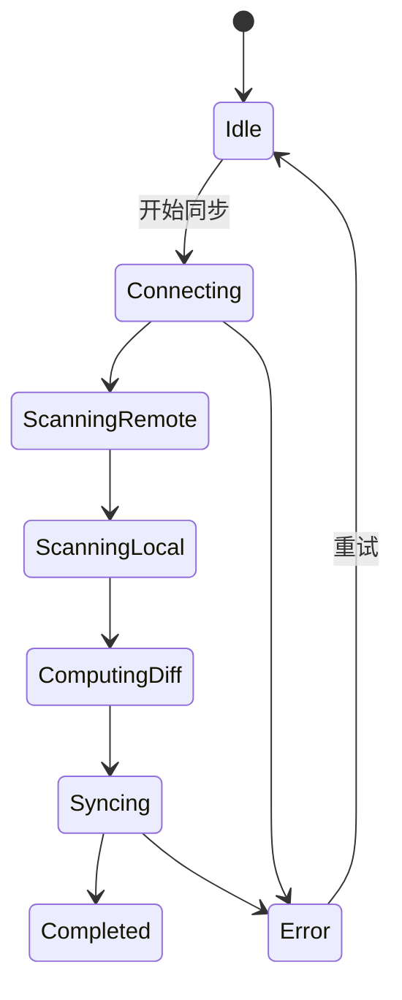

# 同步与云 域逆向 PRD（聚合域）

> 生成日期：2026-05-30
> 目标域：`sync-cloud`（聚合：WebDAV 同步 / Cloud Sync / Lumina Cloud 许可证 / Rust 中继与协作 / 移动网关）
> 项目类型：fullstack（前端 + Rust 后端）
> 代码版本：基于 `main` @ `92e125c7`
> 口径：以"实现现状"为准，对未实现/空实现明确标注缺口

## 目录

1. 概述
2. 功能需求
3. 状态机
4. 交互规范
5. 非功能需求
6. 风险与依赖
7. 附录：发现的问题

---

## 1. 概述

### 1.1 业务背景

本域围绕"数据跨设备/跨网络流动"与"商业化"叙事，包含 5 个子域。**关键事实：桌面端多个子域处于迁移中断状态**——WebDAV 同步编排、移动网关 IPC 在 Electron 迁移后未落地；Lumina Cloud 许可证 UI 被孤立；只有 Rust 后端与 Cloud Sync 客户端是完整的。

### 1.2 目标用户

| 角色 | 说明 | 核心操作 |
|------|------|---------|
| 多设备用户 | 桌面↔移动同步 | WebDAV / 移动网关配对 |
| 自部署用户 | 自建中继 | 部署 server、账号/工作区 |
| 付费用户 | 不想配 Key | 输入许可证用 Lumina Cloud |
| 协作用户 | 团队协作 | 组织/项目/任务/批注 |

### 1.3 页面清单

| 入口 | 位置 | 说明 |
|------|------|------|
| 同步设置 | 设置 → 同步 | `WebDAVSettings.tsx` + `MobileGatewaySection.tsx` |
| Account（许可证） | 设置 → Account | `LicenseSettings.tsx`（**不渲染**） |
| 自部署后端 | 外部 | `server/` |

---

## 2. 功能需求

### 2.1 WebDAV 同步（FR-01｜func_code: `func_webdav_sync`）

**功能描述**：配置 WebDAV 服务器，预览同步计划并执行双向同步。

**业务规则**：
1. 服务层全部通过 `invoke('webdav_*')`（`services/webdav/index.ts:21-202`）。
2. 配置持久化剔除密码（`useWebDAVStore.ts:301-311`）。
3. **Electron 下同步为空实现**：`webdav_compute_sync_plan` 永远返回空计划，`webdav_execute_sync/quick_sync` 永远返回 `success:true, 0/0/0`（`handlers/webdav.ts:246-270`）。
4. **自动同步开关无调度器**（`WebDAVSettings.tsx:392-407`）。
5. **`loadWebDAVConfig`/`saveWebDAVConfig` 从未被调用**，密码跨重启丢失（`services/webdav/index.ts:196-202`）。

**状态机**：`SyncStage: Idle|Connecting|ScanningRemote|ScanningLocal|ComputingDiff|Syncing|Completed|Error`；`SyncAction: Upload|Download|DeleteRemote|DeleteLocal|Conflict|Skip`（`types.ts:67-110`）。

**验收标准**：
- [ ] 配置并测试连接成功。
- [ ] 预览同步计划显示真实差异（**当前永远为空，未达标**）。
- [ ] 执行同步真实传输文件（**当前假成功，未达标**）。

### 2.2 Cloud Sync（FR-02｜func_code: `func_cloud_account`）

**功能描述**：注册/登录自部署服务器，选择/新建工作区，派生 WebDAV 配置。

**业务规则**：
1. HTTP 客户端 `/auth/register`、`/auth/login`、`/auth/refresh`、`/workspaces`（`cloudSync/client.ts:80-108`）。
2. token 存安全存储（keychain），持久化时剥离，靠 `rehydrateToken` 恢复（`useCloudSyncStore.ts:191-216`）。
3. 派生：`server_url=${base}/dav`，`remote_base_path=/${workspaceId}`（`cloudSync/client.ts:21-38`）。
4. `refreshSession`/`loadWorkspaces` 无自动调用（缺口）。
5. **同步仍落回 WebDAV 空实现**。

**验收标准**：
- [ ] 注册/登录成功并保存 token。
- [ ] 选择工作区后派生 DAV 配置。

### 2.3 Lumina Cloud 许可证（FR-03｜func_code: `func_license`）

**功能描述**：粘贴许可证 → 离线 Ed25519 校验 → 存 keychain → 作为第 12 个 provider 使用 → 展示配额。

**业务规则**：
1. 校验用 `@noble/ed25519`，base64url 解码 + 签名校验，**永不抛异常**（`luminaCloud/verify.ts:23-50`）。
2. keychain 存储：mac/Win `safeStorage`；Linux 无 keychain 回退 `0600` 明文文件（`handlers/luminaCloudLicense.ts:39-77`）。
3. 可见性需 `cloud_ai` feature 且 `VITE_ROMANTSY_ENABLE_CLOUD==='1'`（`luminaCloud.ts:54-58`）。
4. **UI 被孤立**：`SettingsModal` 的 `account` tab 不在 `TAB_ORDER` 且返回 null（`SettingsModal.tsx:19,30-36,76-77`）。
5. **公钥为占位符** `AAAA...=`（`PUBLIC_KEY.ts:12`），真实校验必失败。
6. `refreshFromKeychain` 从未在启动调用（`useLicenseStore.ts:63-81`）。
7. 撤销缓存 24h TTL、fail-open、未持久化（`revocations.ts:41-136`）。

**验收标准**：
- [ ] 输入许可证后离线校验通过并存储（**公钥占位，未达标**）。
- [ ] AI 设置出现 Lumina Cloud provider。
- [ ] 配额面板显示用量。

### 2.4 自部署中继与协作（FR-04｜func_code: `func_relay_collab`）

**功能描述**：Rust 后端提供账号/组织/项目/任务/批注/通知、WebDAV 文件存储、Yjs 实时协作、设备中继、公开站点发布。

**业务规则**：
1. 技术栈 axum + sqlx(SQLite) + yrs CRDT；密码 Argon2；JWT HS256 TTL 7 天（`auth.rs:9-59`）。
2. 路由见 `server/src/main.rs:90-169`（40+ 条）。
3. WebDAV 单文件上限 200MB，路径穿越防护（`dav.rs:21,400-411`）。
4. 协作帧首字节 `MSG_SYNC=0`/`MSG_AWARENESS=1`，30s 脏数据落盘（`collab.rs:18-23`）。
5. 中继按 `user_id` 一对一配对，同端多设备互相覆盖（`relay.rs:61-85`）。
6. 限流 governor 按 IP，`X-Forwarded-For` 仅在 `trusted_proxy_hops>0` 信任（`rate_limit.rs:18-70`）。
7. 生产强制 `LUMINA_JWT_SECRET`（`main.rs:32-41`）。

**验收标准**：
- [ ] 注册/登录返回 JWT。
- [ ] WebDAV PROPFIND/GET/PUT 正常。
- [ ] 协作 WS 同步文档。

### 2.5 移动网关（FR-05｜func_code: `func_mobile_gateway`）

**功能描述**：启动 LAN 网关，生成 QR + token 配对 payload，移动端扫码直连同步。

**业务规则**：
1. UI 调 `mobile_get_status/mobile_start_server/mobile_stop_server`（`MobileGatewaySection.tsx:37,71,92`）。
2. **Electron 主进程无 mobile 命令组**，必然 `Unknown command`（`ipc.ts:171-215`）。
3. `mobile_set_workspace` 同样不存在（`useFileStore.ts:2522`）。
4. 协议文档定义消息类型 `pair/session_create/command/ping/...`（`docs/mobile-wifi-protocol.md`）。
5. iOS/Android 客户端已实现扫码配对（`MobileGatewayStore.swift:71-131`；`MainActivity.kt:660-836`）。

**验收标准**：
- [ ] 点击启动网关成功显示端口/token（**当前 IPC 缺失，未达标**）。
- [ ] 移动端扫码配对成功（**桌面侧缺失，未达标**）。

---

## 3. 状态机

### 3.1 WebDAV 同步阶段

### 3.2 云账号认证

`CloudAuthStatus: anonymous | authenticating | authenticated`（`useCloudSyncStore.ts:17`）。

### 3.3 许可证状态

`LicenseStatus: idle | loading | valid | invalid`（`luminaCloud/types.ts:88`）。

---

## 4. 交互规范

### 4.1 加载与骨架屏策略

| 区块 | 加载方式 | 代码位置 |
|------|---------|---------|
| 同步阶段 | 阶段文案映射 | `useWebDAVStore.ts:316-342` |
| 许可证校验 | `Verifying…` | `LicenseSettings.tsx:107` |
| 配额 | `Loading usage…` | `CloudUsagePanel.tsx:63-77` |

### 4.2 空状态设计

| 区块 | 空状态文案 | 代码位置 |
|------|----------|---------|
| 无同步时间 | `cloudNeverSynced` | `WebDAVSettings.tsx:162` |
| 配额无许可证 | 返回 null（不闪空态） | `CloudUsagePanel.tsx:50` |
| 同步计划空 | 仅显示计数 | `WebDAVSettings.tsx:476` |

### 4.3 错误状态设计

| 场景 | 展示方式 | 代码位置 |
|------|---------|---------|
| 同步/连接错误 | 合并错误 + 关闭按钮 | `WebDAVSettings.tsx:77,201-213` |
| 配额拉取失败 | 保留旧值 + `Retrying…` | `CloudUsagePanel.tsx:63-77` |
| 许可证失败 | `Could not verify this license...` | `LicenseSettings.tsx:124-130` |

### 4.4 操作反馈规范

| 场景 | 反馈 | 代码位置 |
|------|------|---------|
| 登录/注册 | `authenticating` loading | `WebDAVSettings.tsx:298,307` |
| 移除许可证 | 二次确认 | `LicenseSettings.tsx` |

---

## 5. 非功能需求

### 5.1 性能要求

- 撤销缓存 24h TTL + 请求合并。
- 协作 30s 定时 flush。

### 5.2 安全要求

- 密码 Argon2、JWT HS256、WebDAV 200MB 上限、路径穿越防护、限流。
- 密钥仅存 keychain（Linux 回退 0600 明文文件）。
- **缺口**：中继无 token 配对校验；协作无文档级 ACL；awareness 无大小上限。

---

## 6. 风险与依赖

### 6.1 前置依赖

| 依赖项 | 类型 | 说明 |
|--------|------|------|
| 自部署 server | 内部服务 | Cloud Sync / WebDAV / 协作 / 中继依赖 |
| lumina-cloud | 外部闭源服务 | 许可证签发 + AI 网关 |
| OS keychain | 系统 | token/许可证存储 |
| WebDAV 服务器 | 外部服务 | 文件同步目标 |

### 6.2 已知风险与约束

| 风险/约束 | 影响 | 现有处理 / 建议 |
|---------|------|--------------|
| WebDAV 空实现 | 用户以为同步成功 | 迁移编排或显式禁用 |
| 移动网关 IPC 缺失 | 功能完全不可用 | 实现或隐藏入口 |
| 许可证 UI 孤立 + 公钥占位 | 无法商业化 | 恢复 tab + 替换公钥 |
| 域名不一致 | 请求失败 | 统一 `api.romantsy-note.com` |
| 中继同端覆盖/无 ACL | 多设备/安全 | 多设备 key + 文档 ACL |
| token 过期不自动刷新 | 频繁重登 | 定时 refresh |

---

## 7. 附录：发现的问题

| 级别 | 类型 | 影响范围 | 发现路径（文件:行） | 问题描述 |
|------|------|---------|-------------------|---------|
| P0 | 空实现 | WebDAV 同步 | `handlers/webdav.ts:246-270` | compute_sync_plan 恒空、execute_sync 假成功 |
| P0 | 功能缺失 | 移动网关 | `electron/main/ipc.ts:171-215`；`MobileGatewaySection.tsx:37` | mobile_* 命令无实现 |
| P0 | 功能不可达 | 许可证 | `SettingsModal.tsx:19,30-36,76-77` | account tab 不渲染，许可证 UI 孤立 |
| P0 | 配置错误 | 许可证 | `luminaCloud/PUBLIC_KEY.ts:12` | 公钥为全 A 占位符，校验必失败 |
| P1 | 配置丢失 | WebDAV | `services/webdav/index.ts:196-202`；`useWebDAVStore.ts:303-310` | load/save 助手未调用，密码跨重启丢失 |
| P1 | 死开关 | WebDAV | `WebDAVSettings.tsx:392-407` | 自动同步无调度器 |
| P1 | 契约漂移 | 云域名 | `cloud/CONTRACT.md:10` vs `luminaCloud/client.ts:17` | 文档 `api.romantsy-note.com`，代码 `api.lumina-note.com` |
| P1 | 启动缺失 | 许可证 | `useLicenseStore.ts:63-81` | refreshFromKeychain 未调用，许可证不水合 |
| P2 | 安全 | 中继 | `relay.rs:61-85,175-206` | 无 token 配对校验，同端多设备互相覆盖 |
| P2 | 安全 | 协作 | `collab.rs:205-221` | 无文档级 ACL，任意登录用户可加入 |
| P2 | 持久化 | 撤销列表 | `revocations.ts:107-128` | 未持久化，跨重启失效 |
| P2 | 安全 | 默认密钥 | `config.rs:20-21` | `dev-secret-change-me` 默认，仅 release 强制 |
| P3 | 文档漂移 | 云任务 | `cloud/TASKS.md:139` | 声称 C10 Account tab 已完成，实际已不存在 |
