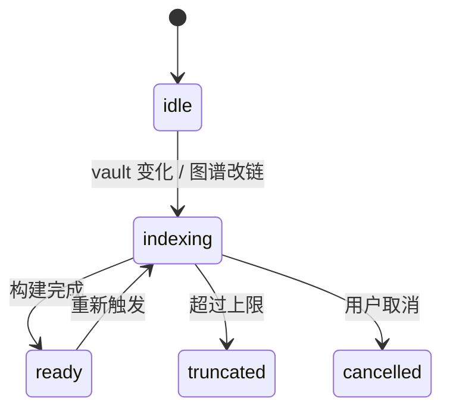

# 双向链接与知识图谱 域逆向 PRD

> 生成日期：2026-05-30
> 目标域：`wiki-graph`
> 项目类型：fullstack（桌面端为主，前端视角）
> 代码版本：基于 `main` @ `92e125c7`
> 口径：以"实现现状"为准，对未实现/死代码明确标注缺口

## 目录

1. 概述
2. 功能需求
3. 状态机
4. 交互规范
5. 非功能需求
6. 风险与依赖
7. 附录：发现的问题

---

## 1. 概述

### 1.1 业务背景

本域是产品的差异化能力：用 `[[WikiLinks]]` 把笔记连成网络，并提供全局/局部图谱可视化、反链、标签与大纲。前端基于内存索引 `useNoteIndexStore` 与自研 Canvas 2D 物理引擎实现（无 d3）。此外主进程还有一套"wiki 自动合成"后端能力（用 opencode 生成 wiki 页面），但**默认关闭且无 UI**。

### 1.2 目标用户

| 角色 | 说明 | 核心操作 |
|------|------|---------|
| 知识网络用户 | 用双链组织知识 | 建链、看反链、看图谱 |
| 探索用户 | 发现笔记关系 | 图谱缩放/点击、悬停预览 |
| 长文用户 | 长文档导航 | 大纲跳转 |

### 1.3 页面清单

| 入口 | 位置 | 说明 |
|------|------|------|
| 右栏 Links | 右面板 | 反链面板 `RightPanel.tsx:25` |
| 右栏 Tags | 右面板 | 标签面板 `RightPanel.tsx:116` |
| 右栏 Outline | 右面板 | 大纲面板 `RightPanel.tsx:205` |
| 全局图谱 | graph 标签页 | `KnowledgeGraph.tsx` |
| 局部图谱 | 编辑器右上角 | `LocalGraph.tsx` |

---

## 2. 功能需求

### 2.1 WikiLink（FR-01｜func_code: `func_wikilink`）

#### 2.1.1 链接渲染与跳转

**功能描述**：正文中 `[[Note]]` 或 `[[Note|alias]]` 渲染为可点击链接；Ctrl/Cmd+点击跳转到目标笔记。

**业务规则**：
1. 解析按文件名 stem 大小写不敏感匹配，返回**首个**匹配（`wikiLinks.ts:24-45`）→ 同名笔记有歧义。
2. 编辑器装饰 `.wikilink`（`CodeMirrorEditor.tsx:4125-4148`）。
3. 未解析链接点击仅 `console.log("Not found")`（`CodeMirrorEditor.tsx:5734`）。
4. 无 `[[` 自动补全（缺口）。

**交互行为**：

| 维度 | 描述 | 代码位置 |
|------|------|---------|
| 悬停预览 | 悬停显示预览卡（FIFO 缓存上限 64、正文截断 220 字符） | `WikiLinkHoverCard.tsx:16`, `wikiLinks.ts:19-20,106-122` |
| 空/未解析 | `No note named "{name}"` | `WikiLinkHoverCard.tsx:84-90` |

**验收标准**：
- [ ] `[[Note]]` 渲染为可点击链接。
- [ ] Ctrl/Cmd+点击跳转到目标笔记。
- [ ] 未解析链接有明确提示（当前仅 console，未达标）。

### 2.2 反链 / 标签 / 大纲（FR-02｜func_code: `func_backlinks`）

**功能描述**：右栏展示当前笔记的反链（含上下文行）、标签汇总、标题大纲。

**业务规则**：
1. 反链按 `[[linkName` 字符串逐行找首个出现行作为上下文（`useNoteIndexStore.ts:224-251`）。
2. 标签用 `#tag` 正则提取，**注释称排除代码块/URL 但实现未做**（`useNoteIndexStore.ts:16-25`）。
3. 大纲来自 `headings.ts:50-84`，点击派发 `outline-scroll-to`。

**交互行为**：

| 区块 | 空状态文案 | 代码位置 |
|------|----------|---------|
| 反链 | 未开笔记/索引中/无反链 | `RightPanel.tsx:46-73` |
| 标签 | 索引中/无标签 | `RightPanel.tsx:135-149` |

**验收标准**：
- [ ] 有反链的笔记在 Links 面板列出引用位置。
- [ ] 点击大纲项编辑器滚动到对应标题。

### 2.3 知识图谱（FR-03｜func_code: `func_graph`）

**功能描述**：全局图谱（文件夹层级 + 双链边）与局部图谱（当前笔记邻域）以 Canvas 渲染，支持缩放/平移/选择/右键操作。

**业务规则**：
1. 纯 Canvas 2D + 自研 `PhysicsEngine`，无 d3（`KnowledgeGraph.tsx:46,550-829`）。
2. 节点上限：全局 1200（`knowledgeGraphData.ts:38`）、局部 80（`localGraphData.ts:33`），仅状态文案告知。
3. 节点数 > 600 时物理步进降频为每 3 帧（`KnowledgeGraph.tsx:568-572`）。
4. 图谱内"创建连接"在源笔记追加 `[[label]]`（basename，非路径）（`KnowledgeGraph.tsx:194-199`）。
5. 边类型 `link | hierarchy`（`knowledgeGraphData.ts:19-23`）。
6. 未解析链接静默丢弃（`knowledgeGraphData.ts:117-119`）。

**交互行为**：

| 维度 | 描述 | 代码位置 |
|------|------|---------|
| 加载状态 | `knowledgeGraph.loadingPreview` | `KnowledgeGraph.tsx:1361` |
| 空状态 | "No linked notes" | `KnowledgeGraph.tsx:1498` |
| 状态条 | 索引中/截断/展示上限 | `KnowledgeGraph.tsx:1220-1245` |
| 创建连接反馈 | 中文 toast | `KnowledgeGraph.tsx:379-412` |

**验收标准**：
- [ ] 全局图谱展示笔记节点与链接边。
- [ ] 缩放/平移/选择节点正常。
- [ ] 右键创建连接后源笔记追加链接。

### 2.4 笔记索引（FR-04｜func_code: `func_build_index`）

**功能描述**：构建内存笔记索引（标题、反链、标签、搜索），供反链/标签/图谱/搜索使用。

**业务规则**：
1. 常量：单文件 2MB、总 50k、并发 16、每 200 文件让出（`useNoteIndexStore.ts:90-103`）。
2. 先 `requestIdleCallback` 延后构建（`useNoteIndexStore.ts:165-167`）。
3. 取消用 `AbortController`（`useNoteIndexStore.ts:107,143-146`）。
4. 触发点：vault 变化、图谱改链；**编辑当前笔记不触发增量更新**（缺口）。

**验收标准**：
- [ ] 打开 vault 后索引自动构建。
- [ ] 诊断面板显示进度与失败文件。

### 2.5 Wiki 自动合成（FR-05｜func_code: `func_wiki_synthesis`）

**功能描述**（后端，未启用）：笔记变更时触发 opencode 合成 wiki 页面，支持 lint 检测断链/孤儿。

**业务规则**：
1. 设置默认 `enabled:false`、`quietMs:30s`、`cooldownMs:5min`（`wiki/settings-store.ts:25-31`）。
2. `start()` 因 enabled=false 不监听（`wiki/manager.ts:96-100`）。
3. `vault_run_lint` 为占位实现，返回空报告（`ipc-dispatch.ts:438-446`）。
4. 所有 wiki IPC 命令**无渲染层调用**（缺口）。

**验收标准**：
- [ ] 启用后笔记变更触发合成（当前不可达）。
- [ ] lint 检测断链/孤儿（当前占位）。

---

## 3. 状态机

### 3.1 索引状态

### 3.2 悬停预览卡状态

`LoadState: idle | loading | ready | missing`（`WikiLinkHoverCard.tsx:16-21`）。

### 3.3 图谱状态

`KnowledgeGraphStatus`（`knowledgeGraphData.ts:25-30`）、`LocalGraphStatus`（`localGraphData.ts:20-25`）。

---

## 4. 交互规范

### 4.1 加载与骨架屏策略

| 区块 | 加载方式 | 代码位置 |
|------|---------|---------|
| 图谱 | 加载预览文案 | `KnowledgeGraph.tsx:1361` |
| 反链/标签 | "索引中" 文案 | `RightPanel.tsx:46,135` |
| 索引诊断 | 进度条 | `IndexDiagnosticsSection.tsx:20` |

### 4.2 空状态设计

| 区块 | 空状态文案 | 代码位置 |
|------|----------|---------|
| 反链 | 无反链提示 | `RightPanel.tsx:46-73` |
| 标签 | 无标签 | `RightPanel.tsx:135-149` |
| 图谱 | "No linked notes" / 硬编码"无关联笔记" | `KnowledgeGraph.tsx:1498`；`LocalGraph.tsx:344` |

### 4.3 错误状态设计

| 场景 | 展示方式 | 代码位置 |
|------|---------|---------|
| 未解析链接 | console.log（无 UI） | `CodeMirrorEditor.tsx:5734` |
| 索引失败文件 | 诊断面板列表 | `IndexDiagnosticsSection.tsx` |

### 4.4 数据展示格式规范

| 数据类型 | 格式规则 | 代码位置 |
|---------|---------|---------|
| 图谱图例 | "索引中/显示 x/y/索引已截断" | `LocalGraph.tsx:363-383` |
| 节点上限 | 全局 1200 / 局部 80 | `knowledgeGraphData.ts:38` |

---

## 5. 非功能需求

### 5.1 性能要求

- 索引并发 16、每 200 文件让出、idle 回调延后。
- 图谱物理步进按节点数降频（>600 → 每 3 帧）。
- 预览缓存 FIFO 上限 64。

### 5.2 已知性能缺口

- 局部/全局图谱常驻 `requestAnimationFrame`，无静止停帧（`LocalGraph.tsx:204-305`；`KnowledgeGraph.tsx:831-838`）。

---

## 6. 风险与依赖

### 6.1 前置依赖

| 依赖项 | 类型 | 说明 |
|--------|------|------|
| `useNoteIndexStore` | 内部 | 反链/标签/图谱/搜索共享 |
| opencode server | 内部 | wiki 合成依赖（未启用） |

### 6.2 已知风险与约束

| 风险/约束 | 影响 | 现有处理 / 建议 |
|---------|------|--------------|
| 同名笔记歧义 | 链接指错 | 按路径解析 |
| 索引不增量更新 | 反链/图谱陈旧 | 编辑后增量重建 |
| 图谱常驻 rAF | 耗电/发热 | 静止停帧 |
| 未解析链接静默 | 用户困惑 | 未解析链接面板 |
| 暗色模式局部图谱固定色 | 对比度风险 | 用主题 token |

---

## 7. 附录：发现的问题

| 级别 | 类型 | 影响范围 | 发现路径（文件:行） | 问题描述 |
|------|------|---------|-------------------|---------|
| P1 | 功能不可达 | wiki 自动合成 | `wiki/settings-store.ts:26`；`ipc-dispatch.ts:438` | 默认关闭且无 UI；lint 为占位 |
| P1 | 数据一致性 | 链接解析 | `useNoteIndexStore.ts:104-110`；`wikiLinks.ts:31-44` | 同名笔记按 basename 首个匹配，指错风险 |
| P1 | 性能 | 图谱 | `LocalGraph.tsx:204-305`；`KnowledgeGraph.tsx:831-838` | 常驻 rAF 无停帧 |
| P2 | 逻辑缺陷 | 标签提取 | `useNoteIndexStore.ts:16-25` | 注释称排除代码块/URL，实现未做 |
| P2 | 死配置 | wiki | `settings-store.ts:20,28` | `cooldownMs` 无消费 |
| P2 | i18n | 图谱 | `KnowledgeGraph.tsx:1280,1438-1451`；`LocalGraph.tsx:344` | 硬编码中文 |
| P2 | 一致性 | 链接提取 | `useNoteIndexStore.ts:5-13` vs `KnowledgeGraph.tsx:35` vs `localGraphData.ts:45` | 多处重复实现，漂移风险 |
| P3 | 暗色模式 | 局部图谱 | `LocalGraph.tsx:236-291` | 固定十六进制色，暗色对比度风险 |
